# Green Pavlodar — қаланы көгалдандыруға арналған ЖИ көмекшісі

[Русский](README.md) · **Қазақша**

Павлодар әкімдігінің маманына арналған веб-қосымша. Ол қаланың нақты учаскесі бойынша үш сұраққа жауап береді: **мұнда не отырғызу керек, оның құны қанша және 20 жылдан кейін не болады**. Одан кейін шешімді құжатқа, бригада тапсырмасына және орындалған жұмысты тексеруге дейін жеткізеді.

**Орнатусыз және құпиясөзсіз ашу:** [green-pavlodar-mock.pages.dev](https://green-pavlodar-mock.pages.dev/?lang=kk) · қазақ және орыс тілдерінде · телефон мен компьютерге бейімделген

[Бұлттағы API — DEMO тіркелгісі қажет](https://green-pavlodar-api.pages.dev/?source=api&lang=kk) · [Режимдердің мүмкіндіктері](#режимдер-және-жарияланған-нұсқалар) · [Код және техникалық тапсырма](#техникалық-тапсырмаға-сәйкестігі) · [Тексерулер](#сапаны-қалай-тексереміз)

**Жобаның негізгі мүмкіндігі:** маман бір учаскеге арналған нұсқаларды салыстырады, түсіндірмесі бар смета мен болжам алады, жұмысты бригадаға тапсырады, ал қарап тексеруден кейін **сақталған болжамды** **бөлек тіркелген нақты нәтижемен** салыстырады. Есептеулер, құжат және сценарийлер ортақ функцияларды қолданады. Күйі белгісіз өсімдік тірі немесе қураған деп есептелмейді.

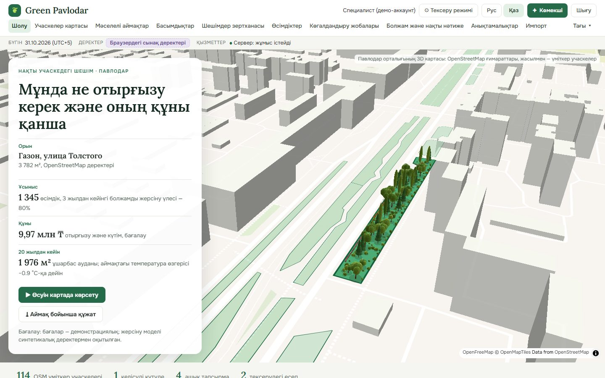

## Бір минутта тексеру

1. [Жария демоны](https://green-pavlodar-mock.pages.dev/?lang=kk) ашыңыз. Есептеулер тікелей браузерде орындалады.
2. Басты экранда **«Газон, улица Толстого»** нақты учаскесі көрсетілген: 3 782 м², 1 345 өсімдік, 9,97 млн ₸. Нысанның атауы бастапқы деректегі қалпында сақталады.
3. **«Өсуін картада көрсету»** түймесін басыңыз. 3D картада отырғызылған өсімдіктердің 5, 10 және 20 жылдан кейінгі көрінісі көрсетіледі.
4. «Шолу» бетіне оралып, **«Аймақ бойынша құжат»**, одан кейін «Қызметтік жазба (Word)» түймесін басыңыз.
5. **«Көмекші»** түймесін басып: «50 млн теңге бюджетке қай аумақтарды көгалдандыруға болады?» деп сұраңыз.
6. Тілді **«Рус»** түймесімен ауыстырып көріңіз.

Экрандағы барлық сан қосымшада есептеледі. Бағалау мен демо деректер арнайы белгіленген.

**Mock** режимінде бригада кабинетін көру үшін «Тексеру режимін» ашып, жұмысшыны немесе бригадирді таңдаңыз. Бұл — серверлік авторизациясыз оқу рөлдері. Бетті толық қайта жүктегеннен кейін mock рөлі қайта таңдалады. Бұлттағы нақты сессия үшін бөлек DEMO қолжетімділігі қажет; құпиясөздер репозиторийде жарияланбайды.

## Режимдер және жарияланған нұсқалар

Жағдай **2026 жылғы 1 қарашада, UTC+5** бойынша тіркелген. Сайттың жариялануы, кодтың болуы және тәуелсіз қабылдау тексеруі — бөлек фактілер.

| Режим | Қайдан ашылады | Жарияланған код және тексеру шегі |
|---|---|---|
| **Тіркелгісіз жария демо** | [Жария сайт](https://green-pavlodar-mock.pages.dev/?lang=kk) · [бекітілген жарияланым](https://d0e985d1.green-pavlodar-mock.pages.dev/) | Mock `84d009e`, жарияланым ID: `d0e985d1-bbd0-4f8c-b1c1-31d20d164ef7`. Есептеулер браузерде орындалады, жұмыс үдерісі синтетикалық деректермен көрсетіледі; деректер бұлттағы базаға жазылмайды. |
| **Тіркелгімен кіретін бұлттағы қосымша** | [API интерфейсі](https://green-pavlodar-api.pages.dev/?source=api&lang=kk) | Frontend `c970264`, жарияланым ID: `a26bd214-1c78-4a83-9536-74a35c85b49f`; оның қолданба коды `84d009e` нұсқасымен бірдей. Backend `3b14927`: PostgreSQL және Supabase-тағы жеке фотосуреттер. Жаңа нұсқаның авторизацияланған тәуелсіз тексеруі әлі күтілуде. |
| **Жергілікті қосымша** | `docker compose up --build`, одан кейін `http://localhost:8080` | Әдепкіде mock іске қосылады. Сервер бапталып, пайдаланушы кіргенде, `?source=api` SQLite пен жергілікті uploads қоймасын қолданады. Бұл орта бұлттағы PostgreSQL-ден бөлек. |

[Жарияланым манифестері және дәлелдері](https://github.com/foxfordkz-cyber/qadamxpavlodar/blob/bc6dae5d7a949d03261fdc6ac7b34b0404378b8a/docs/cloud-publication-handoff-2026-11-01.md) · [жарияланған backend коды мен шектеулері, PR #39](https://github.com/foxfordkz-cyber/qadamxpavlodar/pull/39). Осы жағдай тіркелген кезде #39 әлі `codex/coordinator` тармағына біріктірілмеген; жарияланған сервер нұсқасының коды көрсетілген SHA/PR арқылы қолжетімді.

<details>
<summary>Mock, жергілікті API және бұлт мүмкіндіктерін салыстыру</summary>

| Мүмкіндік | Браузердегі mock | Жергілікті API / SQLite | Бұлттағы API / PostgreSQL |
|---|---|---|---|
| Бар учаскелер, өсімдіктер, смета, болжам, өсу және Word | Бар, бастапқы деректердің түрі белгіленген | Бар | Іске асырылған; жүйеге кіру қажет |
| Ережелерге негізделген көмекші | Бар | Бар, модель істемегендегі резерв те осы | **Маршрут әлі көшірілмеген: 503** |
| Gemini / Groq немесе басқа үйлесімді LLM API қолданатын көмекші | Серверлік кілттер мен модель шақырулары жоқ | Адаптер іске асырылған; кілттер және нақты провайдерді тексеру қажет | **Жарияланған backend-ке қосылмаған** |
| Бригадалар, тапсырмалар, есептер, қабылдау | Оқу сценарийлері; серверлік құқықтар мен дерек сақталуының дәлелі емес | Серверлік рөлдер және сақтау | Жеке фотосуреттерді қоса іске асырылған; жаңа frontend-тің тәуелсіз тексеруі күтілуде |
| Болжам мен нақты нәтиже | Демонстрациялық партиялар және қарап тексерулер | SQLite, болжамның бөлек сақталған нұсқалары және тарих | PostgreSQL, болжам нұсқалары және тарих; mock-тен бөлек тексеріледі |
| Импорт | GeoJSON/KML/CSV алдын ала қарауы; сақтау өшірілген | Қолдау көрсетілетін схемалар шегінде GeoJSON/KML/CSV/SHP/PDF/XLSX алдын ала қарауы және сақтау | Әзірге 503 |
| Мекенжай іздеу, жаңа аймақ құру, күтім күнтізбесін жасау | Демонстрациялық мүмкіндіктер | Іске асырылған | Тиісті маршруттар әзірге 503 қайтарады |

Учаскенің нұсқасы өзгергенде, бұлттағы контекст `409 CONTEXT_STALE` қатесін қайтаруы мүмкін: оны автоматты жаңарту әлі іске асырылмаған. API қателері жасырын түрде mock деректерімен алмастырылмайды. Толық интерфейсті көрсету үшін бірінші, анық белгіленген режимді пайдаланыңыз.

</details>

## Қандай міндетті шешеді

Картадағы көгал ағаш отырғызуға жарамды орын болмауы мүмкін. Оның астында инженерлік желілер, жанында үй қабырғасы немесе кіреберіс болуы, топырағы тұздануы, ал суару суы қолжетімсіз болуы мүмкін. Павлодардың климаты шұғыл континенттік болғандықтан, түрді дұрыс таңдамау өсімдіктің қурауына және бюджет шығынына әкелуі мүмкін.

Green Pavlodar шешімді бір үдеріске біріктіреді:

**учаске → тексерулер → өсімдік таңдау → смета → жерсіну → күтім → экологиялық әсер → басымдық → құжат → бригада тапсырмасы → фотосы бар есеп → қабылдау → болжамды нақты нәтижемен салыстыру**

## Жобаның ерекшеліктері

| Мүмкіндік | Қалай жұмыс істейді | Неге қажет |
|---|---|---|
| **Ортақ есептеу** | Сметаны, жерсінуді және әсерді браузерде де, серверде де бір код есептейді ([`shared/analytics`](apps/web/src/shared/analytics)). | Карта, құжат және көмекші бірдей есеп нәтижелерін қолданады. |
| **Нақты картадағы өсу** | Сметадағы өсімдіктер OSM 3D картасында өседі; жерсіну болжамына сәйкес қураған өсімдіктер көріністен алынады. | Шешім нақты учаскеде көрінеді. |
| **Көмекші құралдар арқылы жұмыс істейді** | Жергілікті API-де бапталған модель есептеу модульдеріне жүгінеді. Mock және жергілікті API резервінде ережелер қолданылады, бұл тиісті белгімен көрсетіледі. Бұлттағы маршрут әлі көшірілмеген. | Жауап әдісін және дереккөздерін тексеруге болады; модель есептеуді алмастырмайды. |
| **Шешімдер зертханасы** | Бір бюджетке арналған үш стратегияны салыстырады және су азайғандағы жағдайды тексереді. | Баламалардың артықшылықтары мен шектеулерін талқылауға болады. |
| **Болжам мен нақты нәтиже** | Болжамның сақталған нұсқасы өзгермейді, қарап тексерулер бөлек сақталады. Белгісіз күй тірі немесе қураған деп есептелмейді. | Болжамды өсімдіктің нақты күйімен дұрыс салыстыруға болады. |
| **Толық жұмыс үдерісі** | Маман, әкімші, тек қарау, бригадир және жұмысшы рөлдері; фотосы бар есеп және қабылдау. | Шешім учаскедегі жұмысқа айналады, нәтижесі қайта тексеріледі. |
| **Екі тіл** | Интерфейс, Word қызметтік жазбасы және жұмысшы кабинеті қазақ және орыс тілдерінде. Қаріптер барлық қазақ әрпін қамтиды және жинаққа енгізілген. | Әкімдік құжатты екі тілде пайдалана алады. |

## Интерфейс көріністері

### Аймақ карточкасы: өсімдік таңдау, смета, жерсіну

Алдымен міндетті шектеулер тексеріледі: инвазиялық қасиеттер, желілер, аудан, қауіпсіздік. Одан кейін 0–100 аралығында бағаланады: климат 35%, топырақ 25%, қалалық жүктеме 15%, мақсат 15%, жергілікті тәжірибе 10%.

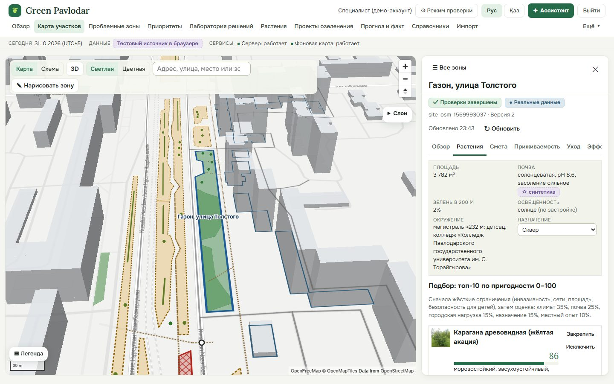

### Түсіндірмесі бар жерсіну болжамы

Карточкада жылдар бойынша болжам, аралық, тәуекел факторлары және модельдің шығу тегі көрсетілген; ережелермен салыстыруға болады. Бұл — синтетикалық деректерге негізделген бағалау, өсімдіктің сақталуына кепілдік емес.

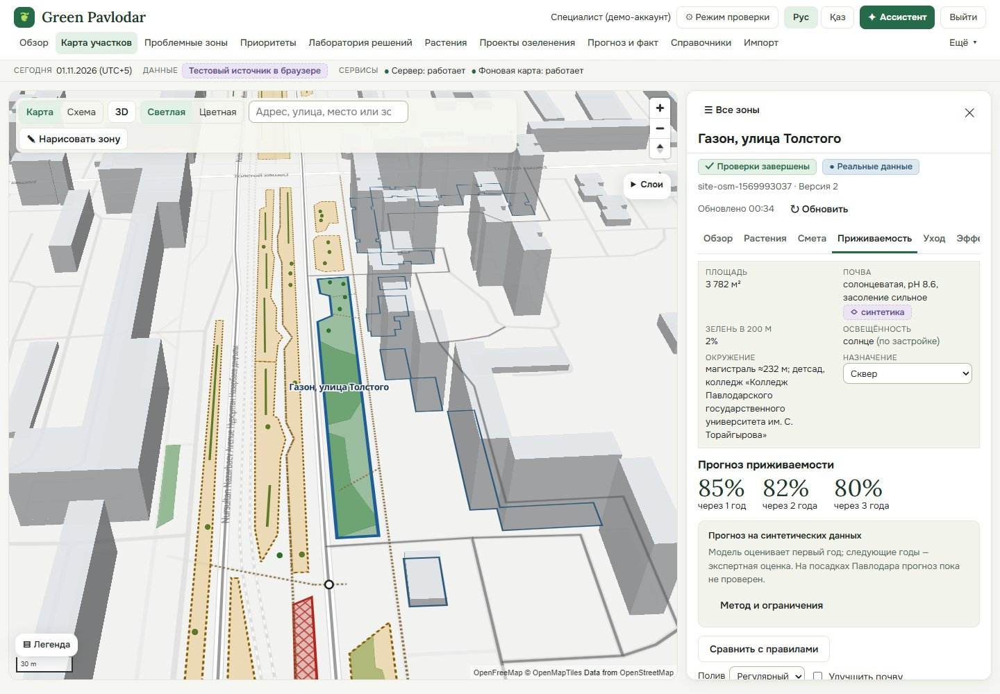

### Уақыт машинасы

Биіктік пен ұшарбас өлшемдері түрлер анықтамалығынан алынады; өсу көрінісі экологиялық әсер есебіндегі үлестерді қолданады.

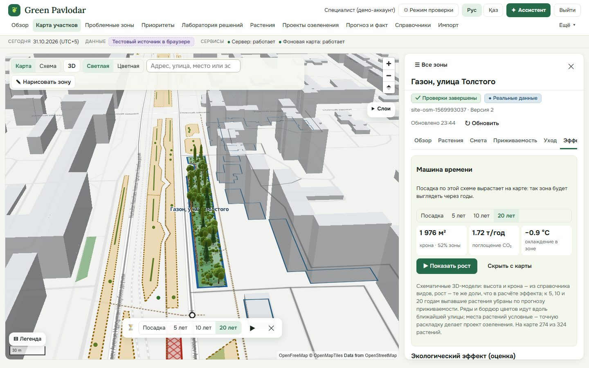

### Мәселелі аймақтар мен басымдықтар

Мәселенің бес түрі маңыздылығымен, себебімен және ұсынылатын әрекетімен көрсетіледі. 0–100 аралығындағы басымдық индексі салмақтар өзгергенде қайта есептеледі, жол картасы бюджетке сай құрылады.

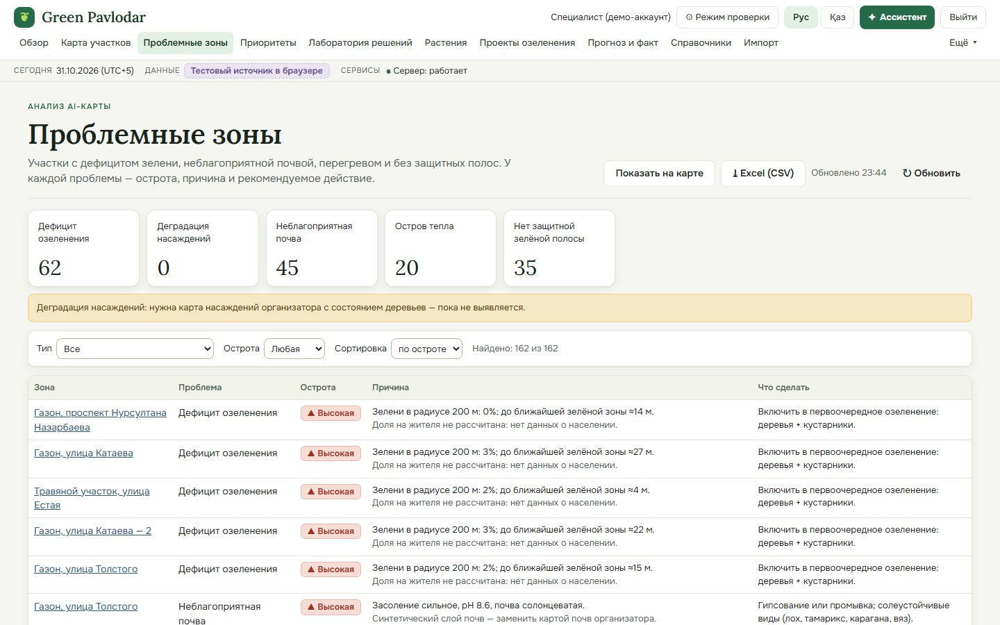

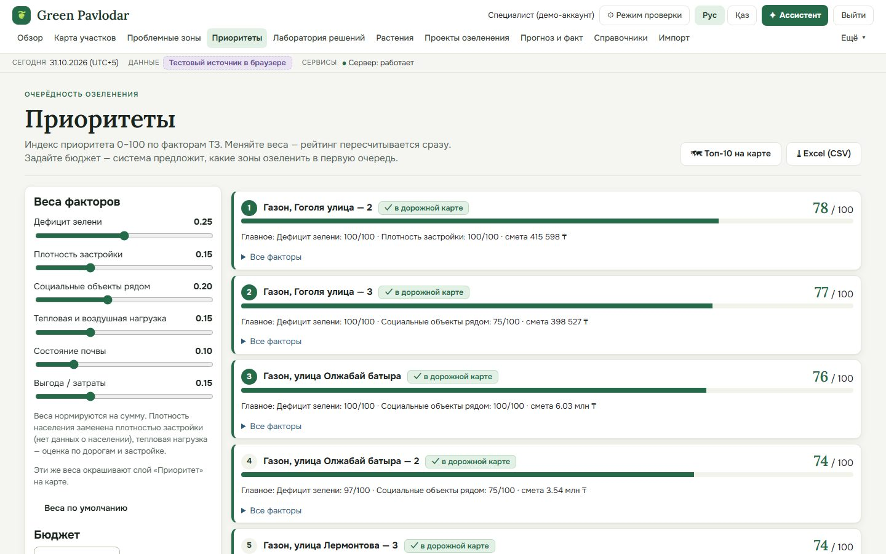

### Көмекші

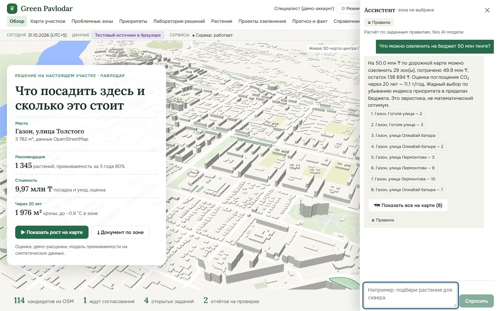

### Шешімдер зертханасы

Суды азайту өсімдіктердің қурау пайызын емес, су тапшылығын көрсетеді: бұл экранда тікелей жазылған.

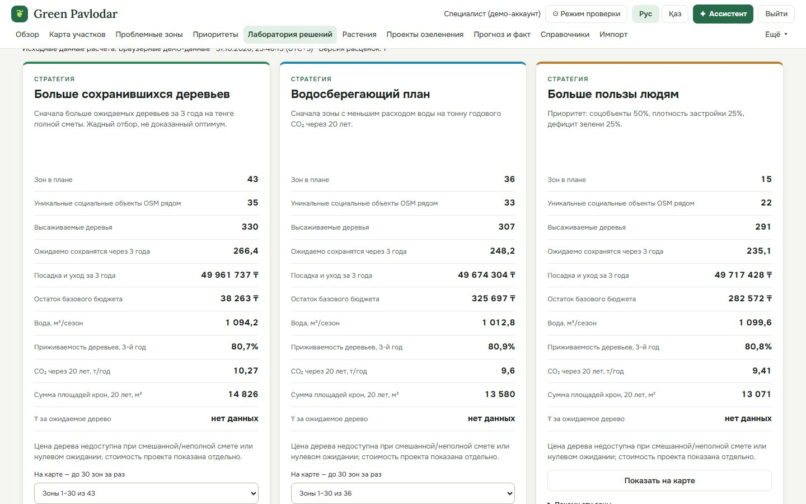

### Болжам мен нақты нәтиже

Бұл экрандағы деректер демонстрациялық және солай белгіленген. Ауытқу бір партияны сипаттайды, модельдің дәлдігін дәлелдемейді.

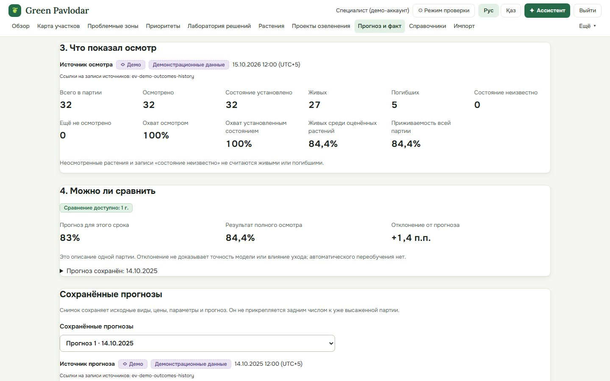

### Құжаттар

Аймақ бойынша есепті PDF ретінде басып шығаруға немесе Excel-ге жүктеуге болады. Word қызметтік жазбасы қазақ немесе орыс тілінде жасалады.

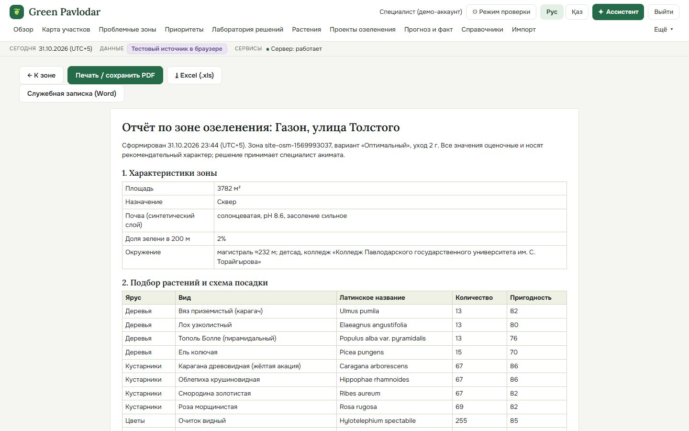

Жаңа жария [Word RU](https://github.com/foxfordkz-cyber/qadamxpavlodar/blob/bc6dae5d7a949d03261fdc6ac7b34b0404378b8a/docs/cloudflare-evidence/final-2026-11-01/public-ui/documents/memo-ru-d0e985d1.docx) және [Word KK](https://github.com/foxfordkz-cyber/qadamxpavlodar/blob/bc6dae5d7a949d03261fdc6ac7b34b0404378b8a/docs/cloudflare-evidence/final-2026-11-01/public-ui/documents/memo-kk-d0e985d1.docx) құжаттары mock-тен жүктеліп, Microsoft Word-та ашылды. [Алғашқы экрандары тексерілді](https://github.com/foxfordkz-cyber/qadamxpavlodar/blob/bc6dae5d7a949d03261fdc6ac7b34b0404378b8a/docs/cloudflare-evidence/final-2026-11-01/public-ui/README.md), баспаға арналған толық беттелуі тексерілген жоқ. Мысал параметрлері: оңтайлы нұсқа, **2 жыл** күтім, 9 970 477,5 ₸; күтім мерзімі өзгерсе, сома да өзгереді.

### Шешімнен бригада жұмысына дейін

Үйлестіруші жоспарды, тағайындауларды және есептерді көреді. Жұмысшы орындалған жұмысты тіркеп, фотосурет қосады; тексеруші есепті қабылдайды немесе қайтарады. Серверлік рөлдер, нұсқалар және қайталанған сұраулар оқу интерфейсінен бөлек тексеріледі.

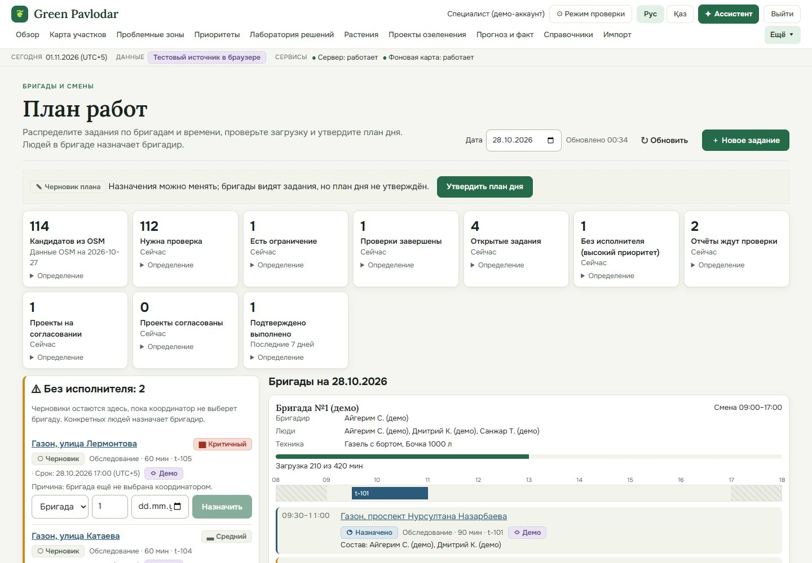

<details>
<summary>Қабылдауға арналған есеп және жұмысшының мәселе туралы қазақша хабарламасы</summary>

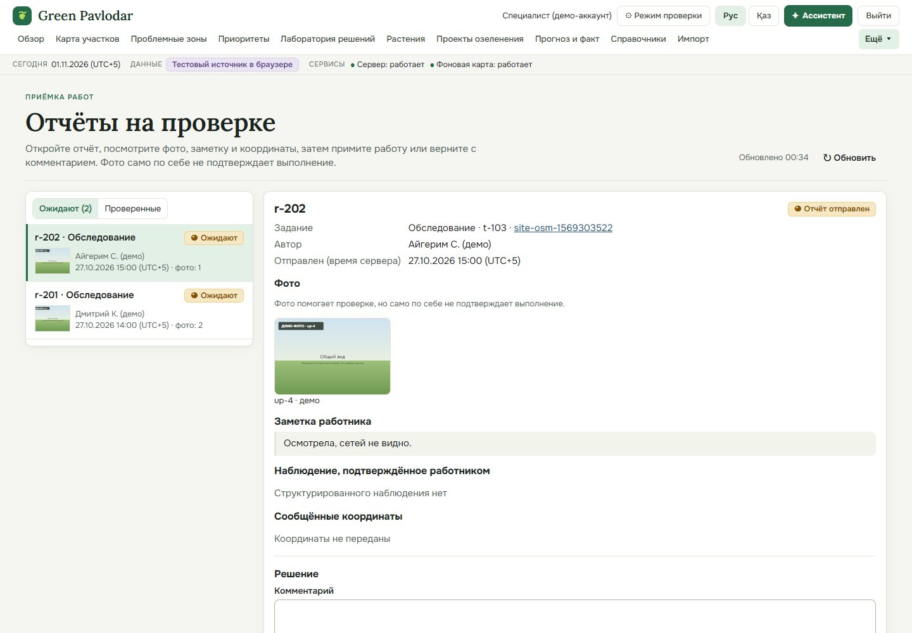

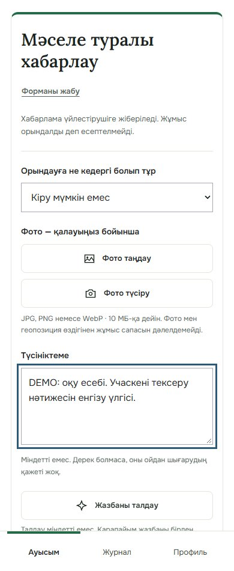

Бұл — жария **mock** суреттері, бұлттағы қабылдау тексеруі емес. Олар интерфейс пен оқу деректерін көрсетеді; нақты есеп пен фотосуреттің сақталуы бөлек серверлік сценарийде тексеріледі.

</details>

<details>
<summary>Импорт және бастапқы деректерді тексеру</summary>

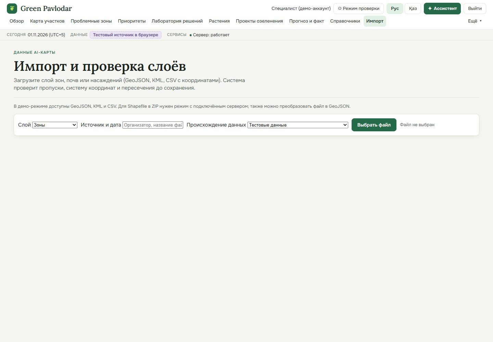

Mock мәтіндік форматтарды алдын ала қарауға мүмкіндік беріп, шектеулерді түсіндіреді. SHP/PDF/XLSX және сақтау жергілікті API-де қолдау табады; жарияланған PostgreSQL backend импортты әлі өңдемейді.

</details>

### Қазақ және орыс тілдері, жұмысшы кабинеті

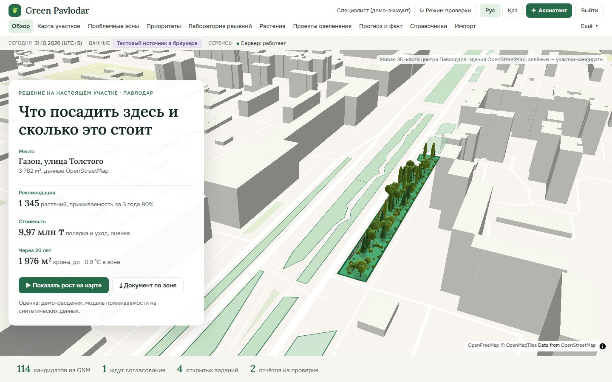

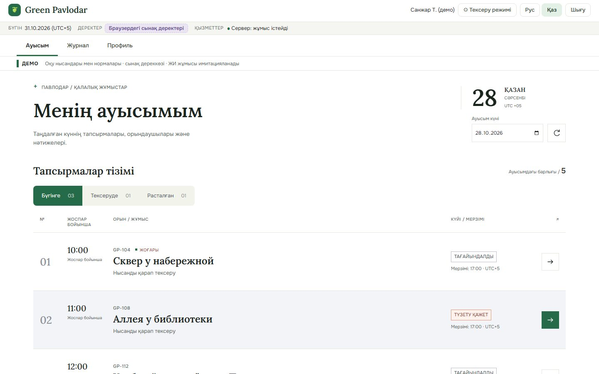

### Телефон

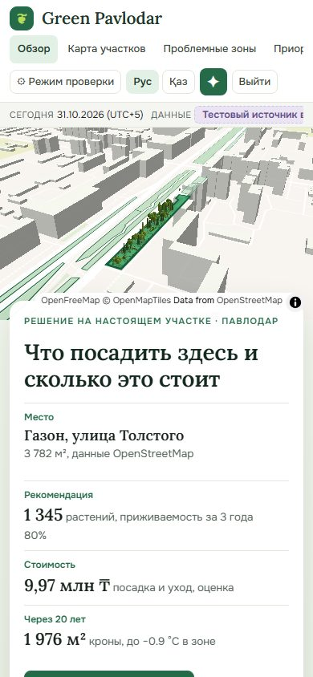

Жерсіну, жұмыс жоспары, есеп, телефондағы хабарлама жобасы және импорттың жаңа суреттері бекітілген `84d009e` жария жинағынан DOM/CSS өзгертусіз түсірілді. [Шығу тегі және хештері](docs/readme/capture-2026-11-01.json). Суреттердегі сандар таңдалған демонстрациялық шарттарға қатысты. Интерфейс суреттері түпнұсқа тілінде сақталған, мәтіні аударылып боялмаған.

## Техникалық тапсырмаға сәйкестігі

| Техникалық тапсырма бөлімі | Өнімдегі орны | Код |
|---|---|---|
| 3.1 Карта, қабаттар, аймақ таңдау, сызу, мекенжай іздеу | Учаскелер картасы | [`map/SiteMap.tsx`](apps/web/src/features/coordinator/map/SiteMap.tsx) |
| 3.1 GeoJSON, KML, CSV, SHP импорты | Импорт | [`tz/ImportPage.tsx`](apps/web/src/features/coordinator/tz/ImportPage.tsx), [`municipal/imports.ts`](apps/server/src/municipal/imports.ts) |
| 3.2 Мәселелі аймақтар | Мәселелі аймақтар, карта қабаты, жүктеп алу | [`analytics/city.ts`](apps/web/src/shared/analytics/city.ts) |
| 3.3 Өсімдік таңдау және отырғызу сызбасы | Аймақ → өсімдіктер | [`analytics/plan.ts`](apps/web/src/shared/analytics/plan.ts) |
| 3.4 Смета және үш нұсқа | Аймақ → смета | [`analytics/plan.ts`](apps/web/src/shared/analytics/plan.ts), [`analytics/rates.ts`](apps/web/src/shared/analytics/rates.ts) |
| 3.5 1, 2 және 3 жылға жерсіну, факторлар, шаралар | Аймақ → жерсіну | [`docs/survival-model.md`](docs/survival-model.md) |
| 3.6 Күтім және күнтізбе | Аймақ → күтім | [`docs/care-schedule.md`](docs/care-schedule.md) |
| 3.7 Басымдық индексі, салмақтар, бюджет | Басымдықтар | [`analytics/city.ts`](apps/web/src/shared/analytics/city.ts) |
| 3.8 5, 10 және 20 жылдағы экологиялық әсер | Аймақ → әсер | [`analytics/plan.ts`](apps/web/src/shared/analytics/plan.ts) |
| 3.9 Жиынтық панель және экспорт | Шолу, есеп, Word | [`docs/example-report.md`](docs/example-report.md) |
| 3.10 ЖИ көмекшісі | Кез келген экрандағы «Көмекші» түймесі | [`tz/llm.ts`](apps/server/src/tz/llm.ts), [`analytics/assistant.ts`](apps/web/src/shared/analytics/assistant.ts) |
| 4 Бір пәрменмен іске қосу | `docker compose up --build` | [`docker-compose.yml`](docker-compose.yml) |
| 5.3 Дереккөздері көрсетілген анықтамалықтар | Анықтамалықтар | [`fixtures/pavlodar`](fixtures/pavlodar/README.md) |
| Тапсырмадан тыс мүмкіндіктер | Шешімдер зертханасы, болжам мен нақты нәтиже, бригада жұмысының үдерісі | [`docs/decision-lab-contract.md`](docs/decision-lab-contract.md), [`docs/outcomes-contract.md`](docs/outcomes-contract.md), [`features/worker`](apps/web/src/features/worker) |

## ЖИ қалай жұмыс істейді

**Көмекші — болжамнан бөлек компонент.** Жергілікті SQLite серверінде OpenAI-үйлесімді API адаптері бар: Gemini, Groq немесе басқа үйлесімді провайдерді баптауға болады. Сегіз құрал: `search_zones`, `find_place`, `analyze_zone`, `compare_variants`, `top_priorities`, `budget_roadmap`, `find_problems`, `search_knowledge`. Олар ортақ есептеулер мен анықтамалықтардың нәтижелерін қайтарады; модельге сандарды сол нәтижелерден алу тапсырылған. Бұл LLM қателеспейді деген кепілдік емес: жауапты маман тексереді.

Жергілікті API-дегі рет: бапталған негізгі модель → резервтік `LLM2_*`/`LLM3_*` → ережелер. Әдіс, модель, шақырылған құралдар және резервке ауысу себебі жауап келісімшартына сәйкес көрсетіледі. Кілттер тек серверде сақталады. [Провайдерлерді баптау](apps/server/env-templates/README.md), тексеру: сервер ортасында бапталған `npm --prefix apps/server run llm:check`. Адаптердің және провайдерді имитациялайтын тесттердің болуы **Gemini/Groq-қа нақты сұрау сәтті орындалғанын дәлелдемейді**.

**Жария mock режимінде ережелер жауап береді. Жарияланған бұлттағы API-де көмекші маршруты әзірге 503 қайтарады.** Оны кілттердің өзі іске қоспайды: құралдар мен маршрутты PostgreSQL-ге бейімдеу қажет. Ағымдағы қабылдау тексеруінде бұлттағы LLM-ге сәтті сұрау расталды деп мәлімделмейді.

**Өсімдік таңдау.** Түсінікті ережелер және салмақталған бағалау қолданылады: әр түрдің балы мен себебі көрінеді.

**Жерсіну.** Сараптамалық ережелерден құрылған 12 000 **синтетикалық** мысалмен оқытылған логистикалық регрессия. Тексеруге бөлек қалдырылған 2 400 мысалда ROC-AUC 0,732, Brier 0,177. Бұл сандар модельдің енгізілген ережелерді қалпына келтіретінін көрсетеді, бірақ **Павлодардағы нақты отырғызулар бойынша дәлдігін растамайды**. Бұл интерфейсте жазылған. Толығырақ: [`docs/survival-model.md`](docs/survival-model.md).

## Деректердің шығу тегі және шартты тұстары

| Дерек | Дереккөз | Мәртебе |
|---|---|---|
| 114 аймақ, ғимараттар, жолдар, жасыл желек | OpenStreetMap (ODbL) | Нақты деректер. Аймақтар — қарастырылатын үміткерлер, отырғызуға бекітілген орындар емес |
| Климат, нормалар, қала туралы фактілер | 34 ашық дереккөз, 33 факт: [`fixtures/pavlodar`](fixtures/pavlodar/README.md) | Сілтемелері берілген |
| 50 түрден тұратын каталог | Команданың жинақтауы, Wikimedia Commons фотолары | Бағалау, дендролог тексеруі қажет |
| Өсімдіктердің қазақша атаулары | [`docs/kk-glossary.md`](docs/kk-glossary.md) | 24 атау расталған; 26 атау ботаник тексергенге дейін орысша көрсетіледі |
| Топырақ | Синтетикалық қабат | Экранда белгіленген, ұйымдастырушының картасымен алмастыруға болады |
| Бағалар | Команданың демонстрациялық бағалары | Әкімші анықтамалықтарда өзгертеді |
| Жерсіну | Синтетикалық модель | Экранда белгіленген |
| Болжам мен нақты нәтиже бөліміндегі бақылаулар | Демонстрациялық | Экранда белгіленген, бұл далалық деректер емес |

Енгізу үшін әкімдіктен топырақ пен жасыл екпелер қабаттары, бағалар, халық туралы деректер және отырғызылған өсімдіктерді қарап тексеру нәтижелері қажет. Демода оқу тіркелгілері мен жазбалары қолданылады; модельді тексеруге дербес мәліметтері алынып тасталған деректер қажет. Шешімді әрдайым маман қабылдайды.

Нақты ML-ге көшу жолы: дербес мәліметтері алынып тасталған отырғызу партияларын, жағдайларын және күтім күндерін қарап тексеру актілерімен байланыстыру; белгісіз күйлерді сақтау; тексеруге тәуелсіз учаскелер мен маусымдарды бөлу. Мұндай деректер алынбайынша, модель қаладағы нақты нәтижелермен оқытылған деп аталмайды. [Модельді тексеру үшін қандай бастапқы деректерді сұрату керек](docs/survival-model.md#какие-первичные-данные-запросить-для-проверки-модели).

## Архитектура

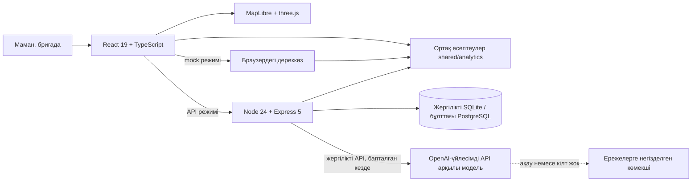

Схема көрінбесе: React/MapLibre ортақ есептеулерді браузерде немесе сервер арқылы қолданады. Жергілікті сервер деректерді SQLite-та сақтайды және LLM-ге жүгіне алады. Бұлттағы сервер PostgreSQL/Supabase қолданады, бірақ маршруттарды көшіру әлі аяқталмаған. Схема режимдердің мүмкіндіктері бірдей дегенді білдірмейді.

Қауіпсіздік: `HttpOnly` және `SameSite=Strict` сессиялары, CSRF, серверде рөлдерді тексеру, қайшылықтарды болдырмауға арналған жазба нұсқалары, қайталанған әрекеттерге қарсы `Idempotency-Key`. Кілттер мен құпиясөздер тек серверде сақталады. Рөл құқықтары [техникалық құжаттамада](docs/readme-technical.md#сервер-и-режим-api) сипатталған.

## Іске қосу

Бір пәрменмен іске қосу үшін Docker қажет:

```bash
docker compose up --build
```

http://localhost:8080 мекенжайын ашыңыз. Әдепкіде серверсіз және құпиясөзсіз режим жұмыс істейді. Нақты серверді пайдалану үшін `apps/server/.env` ішінде `DEMO_PASSWORD` орнатып, http://localhost:8080/?source=api мекенжайын ашыңыз. Толығырақ: [`docs/deployment.md`](docs/deployment.md).

Әзірлеу үшін Node 24 қажет:

```bash
npm --prefix apps/web install
npm --prefix apps/web run dev
```

Жергілікті API демо логиндері: `coordinator`, `admin`, `viewer`, `foreman1`, `worker1`; құпиясөз сервер ортасында орнатылады. Жария **mock** режимінде рөл «Тексеру режимі» түймесі арқылы таңдалады. Бұлттағы API нақты сессияны пайдаланады: қазыларға қолжетімділік бөлек, жабық арнамен беріледі; әкімші құпиясөзі жария материалдарға енгізілмейді.

## Сапаны қалай тексереміз

`84d009e` коммитіндегі нәтижелер; браузер тесттері PR #43 (`c7f1575`) жиынтығымен орындалған:

| Тексеру | Нәтиже |
|---|---|
| Интерфейс және есептеу тесттері | 201/201 |
| Сервер тесттері | 101/101 |
| Жұмысшы кабинеті тесттері | 110/110 |
| Қазақша сөздіктің толықтығы | 1952/1952 кілт |
| Браузерлік E2E, mock режимі | 292 өтті, 0 сәтсіз, 2 өткізіліп жіберілді (компьютер профиліндегі телефон сценарийлері) |
| Браузерлік E2E, оқшауланған жергілікті API / SQLite | 78 өтті, 0 сәтсіз, 0 өткізіліп жіберілді |

Толық E2E нәтижелері капитанның бастапқы жергілікті JSON есептерінен оқылды. [Дербес мәліметсіз жиынтық, хештер және дәлел шектері](docs/readme/verification-2026-11-01.json). Бұл **Айдананың тәуелсіз бұлттағы қабылдау тексеруі емес**: оның [PR #43](https://github.com/foxfordkz-cyber/qadamxpavlodar/pull/43) өз нәтижелері мен мәртебесін тіркейді. Осы тексерудің `84d009e` қосымшасы мен `c7f1575` тесттеріне сәйкестігін оператор көрсеткен; бастапқы есептердің өзінде бұл SHA мәндері жоқ.

| Қосымша тексеру | Нақты расталғаны |
|---|---|
| Жария API/mock файлдары | Жариялау операторы: SHA256 бойынша 136/136 сәйкестік; бөлек анонимді readiness 200 және auth/me 401. Бұл жүйеге кіру мен жұмыс үдерісінің тексеруі емес. |
| Жаңа жария Word RU/KK | Нақты жүктеліп, Microsoft Word-та ашылған; алғашқы экрандары көзбен тексерілген. |
| PostgreSQL backend | #39 авторы өз кандидаты бойынша 105/105 backend және 62/62 нақты PostgreSQL HTTP тексеруін хабарлады; нақты провайдерді тексеру нәтижелері бөлек бар. Код пен жиынтық басқа болғандықтан, оларды жергілікті 101/101 нәтижесіне қоспаймыз. |
| Рөлдер, фото және қайта іске қосу бар тәуелсіз бұлттағы үдеріс | Қолжетімділік пен келісілген тексеруді күтеді; **аяқталды деп жарияланбаған**. |

GitHub Actions типтерді, жинақты, тесттерді және қамтуды тексереді: [`quality.yml`](.github/workflows/quality.yml). Жолдардың қамтылуы бүкіл қосымша үшін емес, Node тесттері жүктейтін код үшін ғана өлшенген: [толығырақ](docs/readme-technical.md#проверки-качества-и-покрытие).

Қайта орындау:

```bash
npm --prefix apps/web ci && npm --prefix apps/web test
npm --prefix apps/server ci && npm --prefix apps/server test
npm --prefix tools/worker-demo test
cd tools/e2e && npm ci && npx playwright install chromium && npm run e2e
```

## Шектеулер

- Жерсіну моделі Павлодардағы нақты отырғызулармен тексерілмеген.
- Әкімдіктің топырақ пен жасыл екпелер туралы деректері әлі қосылмаған. Сондықтан екпелердің тозуы анықталмайды, интерфейс мұны түсіндіреді.
- Бағалар демонстрациялық болғандықтан, смета — бағалау, бекітілген жобалық құжат емес.
- Жұмысшы кабинеті — бейімделетін веб-қосымша, нативті мобильді қосымша емес.
- Картаға интернет қажет. Интернет болмаса, басты экранда иллюстрация көрсетіледі, есептеулер жұмысын жалғастырады.
- Бұлттағы backend-те көмекші/тарих, мекенжай іздеу, жаңа аймақ құру, GIS импорты және күнтізбе жасау әзірге жоқ; режимдер кестесінде толығырақ көрсетілген.
- Жаңа тәуелсіз бұлттағы қабылдау тексеруі және Word-тың барлық бетін қарау аяқталмаған. Есептердің нақты мәртебесі «барлық тексеру өтті» деген жалпы тұжырыммен алмастырылмайды.
- Негізгі тармақ, frontend мұрағатының бастапқы коды және іске қосылған backend SHA мәндері әртүрлі; қолданыстағы жұп тармақтың HEAD мәнінен болжанбай, жарияланымдар кестесінде тіркеледі.

## Қорғауға арналған материалдар

- [Қазақ және орыс тілдеріндегі жаңа таныстырылымға арналған толық промпт](docs/presentation-brief-ru-kk.md): слайд құрылымы, тексерілетін сандар, нақты суреттер және PDF/PPTX талаптары. Бұл — дайындау тапсырмасы, дайын жаңа слайдтар емес.
- [Сценарий және нұсқаулықтар](docs/defense/README.md).
- [Қысқа бейне](docs/defense/media/final-a66d542/green-pavlodar-short-a66d542.mp4) · [толық көрсетілім](docs/defense/media/final-a66d542/green-pavlodar-full-5m-a66d542.mp4).
- [Таныстырылым PDF](docs/defense/media/final-a66d542/green-pavlodar-defense-a66d542.pdf) · [PPTX](docs/defense/media/final-a66d542/green-pavlodar-defense-a66d542.pptx).

Жоғарыдағы бейне мен слайдтар — **a66d542** нұсқасының сақталған материалдары, қазіргі бұлттағы нұсқаның жазбасы емес. Ағымдағы интерфейсті осы README сілтемелері мен жаңа суреттері арқылы тексеруге болады; ескі материалдар жаңа қабылдау тексеруі ретінде ұсынылмайды. [Жарияланым иесінің жаңа тапсыру есебі](https://github.com/foxfordkz-cyber/qadamxpavlodar/blob/bc6dae5d7a949d03261fdc6ac7b34b0404378b8a/docs/defense/release-handoff.md).

## Кодтағы қажетті бөлімдер

| Мүмкіндік | Орны |
|---|---|
| Таңдау, смета, жерсіну, күтім, әсер | [`shared/analytics/plan.ts`](apps/web/src/shared/analytics/plan.ts) |
| Мәселелер, басымдықтар, жол картасы | [`shared/analytics/city.ts`](apps/web/src/shared/analytics/city.ts) |
| Зертхана, болжам мен нақты нәтиже | [`decisionLab.ts`](apps/web/src/shared/analytics/decisionLab.ts), [`outcomes.ts`](apps/web/src/shared/analytics/outcomes.ts) |
| Сервердегі көмекші | [`apps/server/src/tz/llm.ts`](apps/server/src/tz/llm.ts) |
| API келісімшарты, сессиялар, рөлдер | [`apps/server/src/v2`](apps/server/src/v2), [`openapi-v2.json`](apps/server/openapi-v2.json) |
| Экрандар | [`features/coordinator`](apps/web/src/features/coordinator) |
| Жұмысшы кабинеті | [`features/worker`](apps/web/src/features/worker) |
| Браузер тесттері және табылған ақаулар | [`tools/e2e`](tools/e2e), [`BUGS.md`](tools/e2e/BUGS.md) |
| Қорғау сценарийі | [`docs/defense`](docs/defense/README.md) |
| Толық техникалық құжаттама | [`docs/readme-technical.md`](docs/readme-technical.md) |

## Команда

- **Дамир:** капитан, интерфейс пен карта, интеграция, ЖИ.
- **Бекзат:** сервер, жариялау, қазақша мәтінді тексеру.
- **Танирберди:** жұмысшы кабинеті, қорғау материалдары.
- **Айдана:** браузер тесттері және тәуелсіз қабылдау тексеруі.

Команда код жазу мен тексеруде ЖИ құралдарын (Claude, ChatGPT/Codex) қолданды. Шешімдер мен қабылдауға адамдар жауапты болды.

---

Карта деректері © OpenStreetMap қатысушылары (ODbL). Өсімдік фотолары: Wikimedia Commons; авторлар мен лицензиялар қосымшада көрсетілген. Барлық нәтиже бағалау болып табылады және ұсынымдық сипатта берілген.
