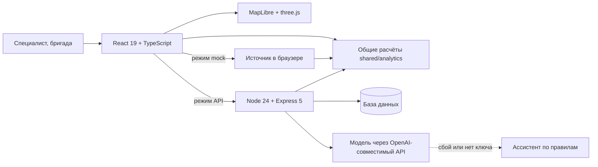

# Green Pavlodar — AI-ассистент для озеленения города

Веб-приложение для специалиста акимата Павлодара. Оно отвечает на три вопроса по конкретному участку города: **что здесь посадить, сколько это стоит и что будет через 20 лет**. Затем доводит решение до документа, заданий бригаде и проверки результата.

**Открыть без установки и пароля:** [green-pavlodar-mock.pages.dev](https://green-pavlodar-mock.pages.dev/) · на русском и казахском · телефон и компьютер


## Проверить за одну минуту

1. Откройте [публичную версию](https://green-pavlodar-mock.pages.dev/). Данные считаются прямо в браузере.
2. На первом экране настоящий участок **«Газон, улица Толстого»**: 3 782 м², 1 345 растений, 9,97 млн ₸.
3. Нажмите **«Показать рост на карте»**. Посадка вырастет на 3D-карте через 5, 10 и 20 лет.
4. Вернитесь на «Обзор» и нажмите **«Документ по зоне»**, затем «Служебная записка (Word)».
5. Нажмите **«Ассистент»** и спросите: «Что можно озеленить на бюджет 50 млн тенге?».
6. Переключите язык на **«Қаз»**.

Все числа на экране посчитаны приложением. Оценки и демо-данные подписаны как таковые.

## Какую задачу решает

Газон на карте ещё не место для дерева. Под ним могут быть сети, рядом стена дома или вход в подъезд, почва может быть засолена, а вода для полива недоступна. В Павлодаре резко континентальный климат, поэтому неудачный выбор вида означает гибель посадки и потерянный бюджет.

Green Pavlodar объединяет решение в одну цепочку:

**участок → проверки → подбор растений → смета → приживаемость → уход → экоэффект → приоритет → документ → задание бригаде → отчёт с фото → приёмка → сравнение прогноза с фактом**

## Чем проект отличается

| Что | Как устроено | Почему это важно |
|---|---|---|
| **Единый расчёт** | Один код считает смету, приживаемость и эффект в браузере и на сервере ([`shared/analytics`](apps/web/src/shared/analytics)). | Карта, документ и ассистент показывают одни и те же числа. |
| **Рост на настоящей карте** | Посадка из сметы растёт на 3D-карте OSM, выпавшие растения исчезают по прогнозу приживаемости. | Решение видно на реальном участке, а не на схеме. |
| **Ассистент работает через инструменты** | Модель получает данные из расчётных модулей. Без модели работают правила, и ответ помечается «Правила». | Ответ опирается на расчёт, а сбой внешней модели не останавливает работу. |
| **Лаборатория решений** | Сравнивает три стратегии под один бюджет и проверяет их при сокращении воды. | Можно обсуждать компромиссы, а не один готовый ответ. |
| **Прогноз и факт** | Снимок прогноза неизменяем, осмотры хранятся отдельно. Неизвестное состояние не считается ни живым, ни погибшим. | Прогноз можно честно сверить с тем, что выросло. |
| **Полный цикл работ** | Роли специалиста, администратора, просмотра, бригадира и работника; отчёт с фото и приёмка. | Решение доходит до работы на участке и обратно. |
| **Два языка** | Интерфейс, служебная записка Word и кабинет работника на русском и казахском. Шрифты содержат все казахские буквы и встроены в сборку. | Документ можно использовать в работе акимата на обоих языках. |

## Как это выглядит

### Карточка зоны: подбор растений, смета, приживаемость

Сначала жёсткие ограничения: инвазивность, сети, площадь, безопасность. Затем оценка 0–100: климат 35%, почва 25%, городская нагрузка 15%, назначение 15%, местный опыт 10%.


### Машина времени

Высота и крона берутся из справочника видов, рост использует те же доли, что расчёт экоэффекта.


### Проблемные зоны и приоритеты

Пять типов проблем с остротой, причиной и действием. Индекс приоритета 0–100 пересчитывается при изменении весов, дорожная карта строится под бюджет.


### Ассистент


### Лаборатория решений

Сокращение воды показывает дефицит, а не процент гибели: на экране это написано прямо.


### Прогноз и факт

Данные на этом экране демонстрационные, и он так и помечен. Отклонение описывает одну партию и не доказывает точность модели.


### Документы

Отчёт по зоне (печать в PDF, Excel) и служебная записка Word на русском или казахском.


### Казахский язык и кабинет работника


### Телефон


## Соответствие ТЗ

| Раздел ТЗ | Где в продукте | Код |
|---|---|---|
| 3.1 Карта, слои, выбор зоны, рисование, поиск по адресу | «Карта участков» | [`map/SiteMap.tsx`](apps/web/src/features/coordinator/map/SiteMap.tsx) |
| 3.1 Импорт GeoJSON, KML, CSV, SHP | «Импорт» | [`tz/ImportPage.tsx`](apps/web/src/features/coordinator/tz/ImportPage.tsx), [`municipal/imports.ts`](apps/server/src/municipal/imports.ts) |
| 3.2 Проблемные зоны | «Проблемные зоны», слой на карте, выгрузка | [`analytics/city.ts`](apps/web/src/shared/analytics/city.ts) |
| 3.3 Подбор растений и схема посадки | Зона → «Растения» | [`analytics/plan.ts`](apps/web/src/shared/analytics/plan.ts) |
| 3.4 Смета и три варианта | Зона → «Смета» | [`analytics/plan.ts`](apps/web/src/shared/analytics/plan.ts), [`analytics/rates.ts`](apps/web/src/shared/analytics/rates.ts) |
| 3.5 Приживаемость на 1, 2 и 3 года, факторы, меры | Зона → «Приживаемость» | [`docs/survival-model.md`](docs/survival-model.md) |
| 3.6 Уход и календарь | Зона → «Уход» | [`docs/care-schedule.md`](docs/care-schedule.md) |
| 3.7 Индекс приоритета, веса, бюджет | «Приоритеты» | [`analytics/city.ts`](apps/web/src/shared/analytics/city.ts) |
| 3.8 Экоэффект на 5, 10 и 20 лет | Зона → «Эффект» | [`analytics/plan.ts`](apps/web/src/shared/analytics/plan.ts) |
| 3.9 Дашборд и экспорт | «Обзор», отчёт, Word | [`docs/example-report.md`](docs/example-report.md) |
| 3.10 AI-ассистент | Кнопка «Ассистент» на любом экране | [`tz/llm.ts`](apps/server/src/tz/llm.ts), [`analytics/assistant.ts`](apps/web/src/shared/analytics/assistant.ts) |
| 4 Запуск одной командой | `docker compose up --build` | [`docker-compose.yml`](docker-compose.yml) |
| 5.3 Справочники с источниками | «Справочники» | [`fixtures/pavlodar`](fixtures/pavlodar/README.md) |
| Сверх ТЗ | Лаборатория решений, Прогноз и факт, цикл работ бригады | [`docs/decision-lab-contract.md`](docs/decision-lab-contract.md), [`docs/outcomes-contract.md`](docs/outcomes-contract.md), [`features/worker`](apps/web/src/features/worker) |

## Как устроен AI

**Ассистент.** Сервер подключает модель с OpenAI-совместимым API и даёт ей восемь инструментов: `search_zones`, `find_place`, `analyze_zone`, `compare_variants`, `top_priorities`, `budget_roadmap`, `find_problems`, `search_knowledge`. Числа модель получает из расчётных модулей. Порядок работы: основная модель, затем резервная, затем правила без модели. Интерфейс подписывает, каким способом получен ответ. На публичной версии без сервера работают правила.

**Подбор растений.** Прозрачные правила и взвешенная оценка: у каждого вида виден балл и причина.

**Приживаемость.** Логистическая регрессия на 12 000 **синтетических** примеров, построенных из экспертных правил. На отложенных 2 400 примерах ROC-AUC 0,732, Brier 0,177. Эти числа показывают, что модель восстанавливает заложенные правила, но **не подтверждают точность на посадках Павлодара**. Об этом сказано в интерфейсе. Подробности: [`docs/survival-model.md`](docs/survival-model.md).

## Откуда данные и что в них условно

| Данные | Источник | Статус |
|---|---|---|
| 114 зон, здания, дороги, зелень | OpenStreetMap (ODbL) | Реальные. Зоны являются кандидатами, а не подтверждёнными местами посадки |
| Климат, нормы, факты о городе | 34 открытых источника, 33 факта: [`fixtures/pavlodar`](fixtures/pavlodar/README.md) | Со ссылками |
| Каталог, 50 видов | Обобщение команды, фото Wikimedia Commons | Оценка, нужна проверка дендрологом |
| Казахские названия растений | [`docs/kk-glossary.md`](docs/kk-glossary.md) | 24 подтверждены, 26 показываются по-русски до проверки ботаником |
| Почвы | Синтетический слой | Подписан на экране, заменяется картой организатора |
| Расценки | Демо-расценки команды | Администратор меняет их в «Справочниках» |
| Приживаемость | Синтетическая модель | Подписана на экране |
| Наблюдения в «Прогнозе и факте» | Демонстрационные | Подписаны на экране, это не полевые данные |

Для внедрения нужны от акимата: слои почв и насаждений, расценки, данные о населении и результаты осмотров посадок. Персональные данные граждан приложение не обрабатывает. Решение всегда принимает специалист.

## Архитектура



Безопасность: сессии с `HttpOnly` и `SameSite=Strict`, CSRF, проверка ролей на сервере, версии записей против конфликтов, `Idempotency-Key` против повторов. Ключи и пароли хранятся только на сервере. Права ролей описаны в [технической документации](docs/readme-technical.md#сервер-и-режим-api).

## Запуск

Одной командой (нужен Docker):

```bash
docker compose up --build
```

Откройте http://localhost:8080. По умолчанию работает режим без сервера и пароля. Режим с настоящим сервером: задайте `DEMO_PASSWORD` в `apps/server/.env` и откройте http://localhost:8080/?source=api. Подробности: [`docs/deployment.md`](docs/deployment.md).

Для разработки (Node 24):

```bash
npm --prefix apps/web install
npm --prefix apps/web run dev
```

Демо-логины для режима API: `coordinator`, `admin`, `viewer`, `foreman1`, `worker1`. В публичной версии роль выбирается кнопкой «Режим проверки».

## Как мы проверяем качество

Результаты на коммите `84d009e`:

| Проверка | Результат |
|---|---|
| Тесты интерфейса и расчётов | 201 из 201 |
| Тесты сервера | 101 из 101 |
| Тесты кабинета работника | 110 из 110 |
| Полнота казахского словаря | 1952 из 1952 ключей |
| Браузерные E2E, режим mock | E2E_MOCK_RESULT |
| Браузерные E2E, настоящий API | E2E_API_RESULT |

GitHub Actions проверяет типы, сборку, тесты и покрытие: [`quality.yml`](.github/workflows/quality.yml). Покрытие строк измерено только для кода, который загружают Node-тесты, а не для всего приложения: [детали](docs/readme-technical.md#проверки-качества-и-покрытие).

Повторить:

```bash
npm --prefix apps/web ci && npm --prefix apps/web test
npm --prefix apps/server ci && npm --prefix apps/server test
npm --prefix tools/worker-demo test
cd tools/e2e && npm ci && npx playwright install chromium && npm run e2e
```

## Ограничения

- Модель приживаемости не проверена на реальных посадках Павлодара.
- Данные акимата о почвах и насаждениях пока не подключены, поэтому тип «Деградация насаждений» не выявляется, и экран это объясняет.
- Расценки демонстрационные, поэтому смета является оценкой, а не проектным документом.
- Кабинет работника является адаптивным веб-приложением, а не нативным приложением.
- Карте нужен интернет. Без него первый экран показывает иллюстрацию, а расчёты продолжают работать.
- Публичная версия может отставать от основной ветки на несколько коммитов.

## Где что смотреть в коде

| Что | Где |
|---|---|
| Подбор, смета, приживаемость, уход, эффект | [`shared/analytics/plan.ts`](apps/web/src/shared/analytics/plan.ts) |
| Проблемы, приоритеты, дорожная карта | [`shared/analytics/city.ts`](apps/web/src/shared/analytics/city.ts) |
| Лаборатория, прогноз и факт | [`decisionLab.ts`](apps/web/src/shared/analytics/decisionLab.ts), [`outcomes.ts`](apps/web/src/shared/analytics/outcomes.ts) |
| Ассистент на сервере | [`apps/server/src/tz/llm.ts`](apps/server/src/tz/llm.ts) |
| Контракт API, сессии, роли | [`apps/server/src/v2`](apps/server/src/v2), [`openapi-v2.json`](apps/server/openapi-v2.json) |
| Экраны | [`features/coordinator`](apps/web/src/features/coordinator) |
| Кабинет работника | [`features/worker`](apps/web/src/features/worker) |
| Браузерные тесты и найденные дефекты | [`tools/e2e`](tools/e2e), [`BUGS.md`](tools/e2e/BUGS.md) |
| Сценарий защиты | [`docs/defense`](docs/defense/README.md) |
| Подробная техническая документация | [`docs/readme-technical.md`](docs/readme-technical.md) |

## Команда

- **Дамир:** капитан, интерфейс и карта, интеграция, AI.
- **Бекзат:** сервер, деплой, вычитка казахского.
- **Танирберди:** кабинет работника, материалы защиты.
- **Айдана:** браузерные тесты и независимая приёмка.

При разработке команда использовала AI-инструменты (Claude, ChatGPT/Codex) для кода и проверки. Решения и приёмка оставались за людьми.

---

Данные карты © участники OpenStreetMap (ODbL). Фото растений: Wikimedia Commons, авторы и лицензии указаны в приложении. Все результаты оценочные и носят рекомендательный характер.
