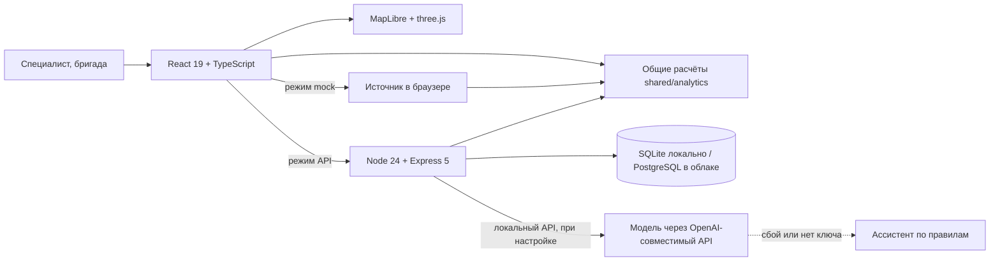

# Green Pavlodar — AI-ассистент для озеленения города

**Русский** · [Қазақша](README.kk.md)

Веб-приложение для специалиста акимата Павлодара. Оно отвечает на три вопроса по конкретному участку города: **что здесь посадить, сколько это стоит и что будет через 20 лет**. Затем доводит решение до документа, заданий бригаде и проверки результата.

**Открыть без установки и пароля:** [green-pavlodar-mock.pages.dev](https://green-pavlodar-mock.pages.dev/) · на русском и казахском · телефон и компьютер

[Облачный API — нужен DEMO-вход](https://green-pavlodar-api.pages.dev/?source=api) · [Что работает в каждом режиме](#режимы-и-публичные-версии) · [Код и ТЗ](#соответствие-тз) · [Проверки](#как-мы-проверяем-качество)

**Главное в проекте:** специалист сравнивает варианты на одном участке, получает объяснимую смету и прогноз, назначает работу бригаде, а после осмотра сравнивает **сохранённый прогноз** с **отдельно записанным фактом**. Расчёты, документ и сценарии используют общие функции. Неизвестные исходы не считаются погибшими или выжившими растениями.


## Проверить за одну минуту

1. Откройте [публичную версию](https://green-pavlodar-mock.pages.dev/). Данные считаются прямо в браузере.
2. На первом экране настоящий участок **«Газон, улица Толстого»**: 3 782 м², 1 345 растений, 9,97 млн ₸.
3. Нажмите **«Показать рост на карте»**. Посадка вырастет на 3D-карте через 5, 10 и 20 лет.
4. Вернитесь на «Обзор» и нажмите **«Документ по зоне»**, затем «Служебная записка (Word)».
5. Нажмите **«Ассистент»** и спросите: «Что можно озеленить на бюджет 50 млн тенге?».
6. Переключите язык на **«Қаз»**.

Все числа на экране посчитаны приложением. Оценки и демо-данные подписаны как таковые.

Для просмотра кабинета бригады в **mock** откройте «Режим проверки» и выберите работника или бригадира. Это учебные роли без серверной авторизации. После полной перезагрузки mock-роль выбирается снова. Для настоящей облачной сессии нужны отдельные DEMO-доступы; пароли в репозитории не публикуются.

## Режимы и публичные версии

Состояние зафиксировано **1 ноября 2026, UTC+5**. Публикация сайта, наличие кода и независимая приёмка — разные факты.

| Режим | Где открыть | Опубликованный код и проверенные границы |
|---|---|---|
| **Публичное демо без входа** | [Production](https://green-pavlodar-mock.pages.dev/) · [фиксированная публикация](https://d0e985d1.green-pavlodar-mock.pages.dev/) | Mock `84d009e`, deployment `d0e985d1-bbd0-4f8c-b1c1-31d20d164ef7`. Расчёты в браузере и синтетический рабочий процесс; данные не записываются в облачную БД. |
| **Облачное приложение с входом** | [API frontend](https://green-pavlodar-api.pages.dev/?source=api) | Frontend `c970264`, deployment `a26bd214-1c78-4a83-9536-74a35c85b49f`; его исходники приложения совпадают с `84d009e`. Backend `3b14927`: PostgreSQL и приватные фотографии в Supabase. Новый независимый авторизованный прогон ещё ожидается. |
| **Локальное приложение** | `docker compose up --build`, затем `http://localhost:8080` | По умолчанию mock. При настроенном сервере и входе `?source=api` использует SQLite и локальные uploads. Это отдельная среда от облачного PostgreSQL. |

[Манифесты и доказательства публикации](https://github.com/foxfordkz-cyber/qadamxpavlodar/blob/bc6dae5d7a949d03261fdc6ac7b34b0404378b8a/docs/cloud-publication-handoff-2026-11-01.md) · [код и ограничения опубликованного backend, PR #39](https://github.com/foxfordkz-cyber/qadamxpavlodar/pull/39). На момент этой фиксации #39 ещё не влит в `codex/coordinator`; код опубликованной серверной версии доступен по указанному SHA/PR.

<details>
<summary>Сравнить возможности mock, локального API и облака</summary>

| Возможность | Mock в браузере | Локальный API / SQLite | Облачный API / PostgreSQL |
|---|---|---|---|
| Существующие участки, растения, смета, прогноз, рост и Word | Да, с маркировкой исходных данных | Да | Реализованы; требуется вход |
| Ассистент по правилам | Да | Да, в том числе резерв при сбое модели | **Маршрут ещё не перенесён: 503** |
| Ассистент с Gemini / Groq или другим совместимым LLM API | Нет серверных ключей и вызовов модели | Адаптер реализован; нужны ключи и проверка живого провайдера | **Не подключён к опубликованному backend** |
| Бригады, задания, отчёты, приёмка | Учебные сценарии; не доказательство серверных прав и сохранности | Серверные роли и хранение | Реализованы, включая приватные фото; независимая проверка нового frontend ожидается |
| Прогноз и факт | Демонстрационные партии и осмотры | SQLite, отдельные снимки прогноза и история | PostgreSQL, снимки и история; проверяется отдельно от mock |
| Импорт | Предпросмотр GeoJSON/KML/CSV; сохранение отключено | Предпросмотр и сохранение; GeoJSON/KML/CSV/SHP/PDF/XLSX в рамках поддерживаемых схем | Пока 503 |
| Поиск адреса, создание новых зон, генерация календаря ухода | Демонстрационные возможности | Реализованы | Соответствующие маршруты пока 503 |

При изменении версии участка облачный контекст может вернуть `409 CONTEXT_STALE`: его автоматическое обновление ещё не реализовано. Ошибки API не заменяются незаметно данными mock. Для демонстрации полного интерфейса используйте первый, явно подписанный режим.

</details>

## Какую задачу решает

Газон на карте ещё не место для дерева. Под ним могут быть сети, рядом стена дома или вход в подъезд, почва может быть засолена, а вода для полива недоступна. В Павлодаре резко континентальный климат, поэтому неудачный выбор вида означает гибель посадки и потерянный бюджет.

Green Pavlodar объединяет решение в одну цепочку:

**участок → проверки → подбор растений → смета → приживаемость → уход → экоэффект → приоритет → документ → задание бригаде → отчёт с фото → приёмка → сравнение прогноза с фактом**

## Чем проект отличается

| Что | Как устроено | Почему это важно |
|---|---|---|
| **Единый расчёт** | Один код считает смету, приживаемость и эффект в браузере и на сервере ([`shared/analytics`](apps/web/src/shared/analytics)). | Карта, документ и ассистент показывают одни и те же числа. |
| **Рост на настоящей карте** | Посадка из сметы растёт на 3D-карте OSM, выпавшие растения исчезают по прогнозу приживаемости. | Решение видно на реальном участке, а не на схеме. |
| **Ассистент работает через инструменты** | В локальном API настроенная модель обращается к расчётным модулям. В mock и резервном режиме локального API работают правила с соответствующей меткой. Облачный маршрут пока не перенесён. | Можно проверить метод ответа и его источники; наличие модели не подменяет расчёт. |
| **Лаборатория решений** | Сравнивает три стратегии под один бюджет и проверяет их при сокращении воды. | Можно обсуждать компромиссы, а не один готовый ответ. |
| **Прогноз и факт** | Снимок прогноза неизменяем, осмотры хранятся отдельно. Неизвестное состояние не считается ни живым, ни погибшим. | Прогноз можно честно сверить с тем, что выросло. |
| **Полный цикл работ** | Роли специалиста, администратора, просмотра, бригадира и работника; отчёт с фото и приёмка. | Решение доходит до работы на участке и обратно. |
| **Два языка** | Интерфейс, служебная записка Word и кабинет работника на русском и казахском. Шрифты содержат все казахские буквы и встроены в сборку. | Документ можно использовать в работе акимата на обоих языках. |

## Как это выглядит

### Карточка зоны: подбор растений, смета, приживаемость

Сначала жёсткие ограничения: инвазивность, сети, площадь, безопасность. Затем оценка 0–100: климат 35%, почва 25%, городская нагрузка 15%, назначение 15%, местный опыт 10%.


### Объяснимый прогноз приживаемости

В карточке видны прогноз по годам, диапазон, факторы риска и происхождение модели; доступно сравнение с правилами. Это оценка на синтетических данных, не гарантия сохранности посадки.


### Машина времени

Высота и крона берутся из справочника видов, рост использует те же доли, что расчёт экоэффекта.


### Проблемные зоны и приоритеты

Пять типов проблем с остротой, причиной и действием. Индекс приоритета 0–100 пересчитывается при изменении весов, дорожная карта строится под бюджет.


### Ассистент


### Лаборатория решений

Сокращение воды показывает дефицит, а не процент гибели: на экране это написано прямо.


### Прогноз и факт

Данные на этом экране демонстрационные, и он так и помечен. Отклонение описывает одну партию и не доказывает точность модели.


### Документы

Отчёт по зоне (печать в PDF, Excel) и служебная записка Word на русском или казахском.


Новые публичные [Word RU](https://github.com/foxfordkz-cyber/qadamxpavlodar/blob/bc6dae5d7a949d03261fdc6ac7b34b0404378b8a/docs/cloudflare-evidence/final-2026-11-01/public-ui/documents/memo-ru-d0e985d1.docx) и [Word KK](https://github.com/foxfordkz-cyber/qadamxpavlodar/blob/bc6dae5d7a949d03261fdc6ac7b34b0404378b8a/docs/cloudflare-evidence/final-2026-11-01/public-ui/documents/memo-kk-d0e985d1.docx) скачаны из mock и открыты в Microsoft Word. [Проверены первые экраны](https://github.com/foxfordkz-cyber/qadamxpavlodar/blob/bc6dae5d7a949d03261fdc6ac7b34b0404378b8a/docs/cloudflare-evidence/final-2026-11-01/public-ui/README.md), не вся печатная вёрстка. Параметры примера: оптимальный вариант, уход **2 года**, 9 970 477,5 ₸; другие сроки ухода дают другую сумму.

### От решения к работе бригады

Координатор видит план, назначения и отчёты. Работник фиксирует выполнение и прикладывает фото; проверяющий принимает или возвращает отчёт. Серверные роли, версии и повторные запросы проверяются отдельно от учебного интерфейса.


<details>
<summary>Отчёт для приёмки и сообщение работника о проблеме на казахском</summary>


Это снимки публичного **mock**, не облачная приёмка. Они показывают интерфейс и учебные данные; сохранность реального отчёта и фотографии проверяется отдельным серверным сценарием.

</details>

<details>
<summary>Импорт и проверка исходных данных</summary>


Mock показывает предпросмотр текстовых форматов и объясняет ограничения. SHP/PDF/XLSX и сохранение поддерживаются локальным API; опубликованный PostgreSQL-backend пока не обслуживает импорт.

</details>

### Казахский язык и кабинет работника


### Телефон


Новые снимки приживаемости, плана работ, отчёта, мобильного черновика и импорта сделаны с фиксированной публичной сборки `84d009e` без изменения DOM/CSS. [Происхождение и хеши](docs/readme/capture-2026-11-01.json). Числа на снимках относятся к выбранным демонстрационным условиям.

## Соответствие ТЗ

| Раздел ТЗ | Где в продукте | Код |
|---|---|---|
| 3.1 Карта, слои, выбор зоны, рисование, поиск по адресу | «Карта участков» | [`map/SiteMap.tsx`](apps/web/src/features/coordinator/map/SiteMap.tsx) |
| 3.1 Импорт GeoJSON, KML, CSV, SHP | «Импорт» | [`tz/ImportPage.tsx`](apps/web/src/features/coordinator/tz/ImportPage.tsx), [`municipal/imports.ts`](apps/server/src/municipal/imports.ts) |
| 3.2 Проблемные зоны | «Проблемные зоны», слой на карте, выгрузка | [`analytics/city.ts`](apps/web/src/shared/analytics/city.ts) |
| 3.3 Подбор растений и схема посадки | Зона → «Растения» | [`analytics/plan.ts`](apps/web/src/shared/analytics/plan.ts) |
| 3.4 Смета и три варианта | Зона → «Смета» | [`analytics/plan.ts`](apps/web/src/shared/analytics/plan.ts), [`analytics/rates.ts`](apps/web/src/shared/analytics/rates.ts) |
| 3.5 Приживаемость на 1, 2 и 3 года, факторы, меры | Зона → «Приживаемость» | [`docs/survival-model.md`](docs/survival-model.md) |
| 3.6 Уход и календарь | Зона → «Уход» | [`docs/care-schedule.md`](docs/care-schedule.md) |
| 3.7 Индекс приоритета, веса, бюджет | «Приоритеты» | [`analytics/city.ts`](apps/web/src/shared/analytics/city.ts) |
| 3.8 Экоэффект на 5, 10 и 20 лет | Зона → «Эффект» | [`analytics/plan.ts`](apps/web/src/shared/analytics/plan.ts) |
| 3.9 Дашборд и экспорт | «Обзор», отчёт, Word | [`docs/example-report.md`](docs/example-report.md) |
| 3.10 AI-ассистент | Кнопка «Ассистент» на любом экране | [`tz/llm.ts`](apps/server/src/tz/llm.ts), [`analytics/assistant.ts`](apps/web/src/shared/analytics/assistant.ts) |
| 4 Запуск одной командой | `docker compose up --build` | [`docker-compose.yml`](docker-compose.yml) |
| 5.3 Справочники с источниками | «Справочники» | [`fixtures/pavlodar`](fixtures/pavlodar/README.md) |
| Сверх ТЗ | Лаборатория решений, Прогноз и факт, цикл работ бригады | [`docs/decision-lab-contract.md`](docs/decision-lab-contract.md), [`docs/outcomes-contract.md`](docs/outcomes-contract.md), [`features/worker`](apps/web/src/features/worker) |

## Как устроен AI

**Ассистент — отдельный от прогноза компонент.** Локальный SQLite-сервер содержит адаптер OpenAI-совместимого API: можно настроить Gemini, Groq или другой совместимый провайдер. Восемь инструментов: `search_zones`, `find_place`, `analyze_zone`, `compare_variants`, `top_priorities`, `budget_roadmap`, `find_problems`, `search_knowledge`. Они возвращают результаты общих расчётов и справочников; модель получает указание брать числа из этих результатов. Это не гарантия отсутствия ошибок LLM: ответ проверяет специалист.

Порядок работы локального API: настроенная основная модель → резервные `LLM2_*`/`LLM3_*` → правила. Метод, модель, вызванные инструменты и причина резерва отображаются по контракту ответа. Ключи находятся только на сервере. [Настройка провайдеров](apps/server/env-templates/README.md), проверка: `npm --prefix apps/server run llm:check` с конфигурацией в серверном окружении. Наличие адаптера и тестов с имитацией провайдера **не доказывает успешный живой вызов Gemini/Groq**.

**В публичном mock отвечают правила. В опубликованном облачном API маршрут ассистента пока возвращает 503.** Ключи сами по себе не подключат его: требуется адаптация инструментов и маршрута к PostgreSQL. Успешный облачный вызов LLM в текущей приёмке не заявляется.

**Подбор растений.** Прозрачные правила и взвешенная оценка: у каждого вида виден балл и причина.

**Приживаемость.** Логистическая регрессия на 12 000 **синтетических** примеров, построенных из экспертных правил. На отложенных 2 400 примерах ROC-AUC 0,732, Brier 0,177. Эти числа показывают, что модель восстанавливает заложенные правила, но **не подтверждают точность на посадках Павлодара**. Об этом сказано в интерфейсе. Подробности: [`docs/survival-model.md`](docs/survival-model.md).

## Откуда данные и что в них условно

| Данные | Источник | Статус |
|---|---|---|
| 114 зон, здания, дороги, зелень | OpenStreetMap (ODbL) | Реальные. Зоны являются кандидатами, а не подтверждёнными местами посадки |
| Климат, нормы, факты о городе | 34 открытых источника, 33 факта: [`fixtures/pavlodar`](fixtures/pavlodar/README.md) | Со ссылками |
| Каталог, 50 видов | Обобщение команды, фото Wikimedia Commons | Оценка, нужна проверка дендрологом |
| Казахские названия растений | [`docs/kk-glossary.md`](docs/kk-glossary.md) | 24 подтверждены, 26 показываются по-русски до проверки ботаником |
| Почвы | Синтетический слой | Подписан на экране, заменяется картой организатора |
| Расценки | Демо-расценки команды | Администратор меняет их в «Справочниках» |
| Приживаемость | Синтетическая модель | Подписана на экране |
| Наблюдения в «Прогнозе и факте» | Демонстрационные | Подписаны на экране, это не полевые данные |

Для внедрения нужны от акимата: слои почв и насаждений, расценки, данные о населении и результаты осмотров посадок. В демонстрации используются учебные аккаунты и записи; для проверки модели нужны обезличенные данные. Решение всегда принимает специалист.

Путь к реальному ML: связать обезличенные партии посадок, условия и даты ухода с актами осмотров; сохранить неизвестные состояния; выделить независимые участки/сезоны для проверки. До получения этих данных модель не называется обученной на городских исходах. [Какие первичные данные запросить](docs/survival-model.md#какие-первичные-данные-запросить-для-проверки-модели).

## Архитектура



Если просмотрщик не отображает схему: React/MapLibre используют общие расчёты в браузере или через сервер. Локальный сервер хранит данные в SQLite и умеет обращаться к LLM. Облачный сервер хранит данные в PostgreSQL/Supabase, но перенос маршрутов ещё не завершён. Схема не означает равенства возможностей режимов.

Безопасность: сессии с `HttpOnly` и `SameSite=Strict`, CSRF, проверка ролей на сервере, версии записей против конфликтов, `Idempotency-Key` против повторов. Ключи и пароли хранятся только на сервере. Права ролей описаны в [технической документации](docs/readme-technical.md#сервер-и-режим-api).

## Запуск

Одной командой (нужен Docker):

```bash
docker compose up --build
```

Откройте http://localhost:8080. По умолчанию работает режим без сервера и пароля. Режим с настоящим сервером: задайте `DEMO_PASSWORD` в `apps/server/.env` и откройте http://localhost:8080/?source=api. Подробности: [`docs/deployment.md`](docs/deployment.md).

Для разработки (Node 24):

```bash
npm --prefix apps/web install
npm --prefix apps/web run dev
```

Демо-логины локального API: `coordinator`, `admin`, `viewer`, `foreman1`, `worker1`; пароль задаётся в серверном окружении. В публичном **mock** роль выбирается кнопкой «Режим проверки». Облачный API использует настоящую сессию: доступ жюри передаётся отдельно закрытым способом, администраторский пароль в публичные материалы не включается.

## Как мы проверяем качество

Результаты на коммите `84d009e`, браузерные тесты с набором из PR #43 (`c7f1575`):

| Проверка | Результат |
|---|---|
| Тесты интерфейса и расчётов | 201 из 201 |
| Тесты сервера | 101 из 101 |
| Тесты кабинета работника | 110 из 110 |
| Полнота казахского словаря | 1952 из 1952 ключей |
| Браузерные E2E, режим mock | 292 прошли, 0 упали, 2 пропущены (мобильные сценарии в настольном профиле) |
| Браузерные E2E, изолированный локальный API / SQLite | 78 прошли, 0 упали, 0 пропущены |

Результаты полного E2E прочитаны из первичных локальных JSON-отчётов капитана. [Обезличенная сводка, хеши и границы доказательств](docs/readme/verification-2026-11-01.json). Это **не независимая облачная приёмка Айданы**: её [PR #43](https://github.com/foxfordkz-cyber/qadamxpavlodar/pull/43) фиксирует собственные результаты и статус. Привязка этого прогона к приложению `84d009e` и тестам `c7f1575` заявлена оператором; сами raw-отчёты не содержат этих SHA.

| Дополнительная проверка | Что именно подтверждено |
|---|---|
| Публичные API/mock файлы | Оператор публикации: 136/136 совпадений SHA256; отдельно анонимные readiness 200 и auth/me 401. Это не проверка входа и рабочего процесса. |
| Новый публичный Word RU/KK | Реальное скачивание и открытие в Microsoft Word; визуально проверены первые экраны. |
| PostgreSQL backend | Автор #39 сообщил 105/105 backend и 62/62 native PostgreSQL HTTP на своём кандидате; отдельно есть проверки реального провайдера. Это другой код и другой набор, их не складываем с локальными 101/101. |
| Независимый облачный цикл с ролями, фото и перезапуском | Ожидает доступа и согласованного прогона; **не объявлен завершённым**. |

GitHub Actions проверяет типы, сборку, тесты и покрытие: [`quality.yml`](.github/workflows/quality.yml). Покрытие строк измерено только для кода, который загружают Node-тесты, а не для всего приложения: [детали](docs/readme-technical.md#проверки-качества-и-покрытие).

Повторить:

```bash
npm --prefix apps/web ci && npm --prefix apps/web test
npm --prefix apps/server ci && npm --prefix apps/server test
npm --prefix tools/worker-demo test
cd tools/e2e && npm ci && npx playwright install chromium && npm run e2e
```

## Ограничения

- Модель приживаемости не проверена на реальных посадках Павлодара.
- Данные акимата о почвах и насаждениях пока не подключены, поэтому тип «Деградация насаждений» не выявляется, и экран это объясняет.
- Расценки демонстрационные, поэтому смета является оценкой, а не проектным документом.
- Кабинет работника является адаптивным веб-приложением, а не нативным приложением.
- Карте нужен интернет. Без него первый экран показывает иллюстрацию, а расчёты продолжают работать.
- В облачном backend пока отсутствуют ассистент/история, поиск адреса, создание зон, GIS-импорт и генерация календаря; подробности приведены в таблице режимов.
- Новая независимая облачная приёмка и полный постраничный просмотр Word не завершены. Состояние отчётов не заменяется общей фразой «все проверки прошли».
- Основная ветка, исходники frontend-архива и запущенный backend имеют разные SHA; актуальная пара фиксируется в таблице публикаций, а не выводится из HEAD ветки.

## Материалы для защиты

- [Полный промпт для новой презентации на русском и казахском](docs/presentation-brief-ru-kk.md): структура слайдов, проверяемые цифры, реальные снимки и требования к PDF/PPTX. Это задание на подготовку, а не готовые новые слайды.
- [Сценарий и инструкции](docs/defense/README.md).
- [Короткое видео](docs/defense/media/final-a66d542/green-pavlodar-short-a66d542.mp4) · [полный показ](docs/defense/media/final-a66d542/green-pavlodar-full-5m-a66d542.mp4).
- [Презентация PDF](docs/defense/media/final-a66d542/green-pavlodar-defense-a66d542.pdf) · [PPTX](docs/defense/media/final-a66d542/green-pavlodar-defense-a66d542.pptx).

Видео и слайды выше — сохранённые материалы **a66d542**, не запись текущей облачной версии. Текущий интерфейс проверяется по ссылкам и новым снимкам этого README; результаты старых медиа не выдаются за новую приёмку. [Свежая передача владельца публикаций](https://github.com/foxfordkz-cyber/qadamxpavlodar/blob/bc6dae5d7a949d03261fdc6ac7b34b0404378b8a/docs/defense/release-handoff.md).

## Где что смотреть в коде

| Что | Где |
|---|---|
| Подбор, смета, приживаемость, уход, эффект | [`shared/analytics/plan.ts`](apps/web/src/shared/analytics/plan.ts) |
| Проблемы, приоритеты, дорожная карта | [`shared/analytics/city.ts`](apps/web/src/shared/analytics/city.ts) |
| Лаборатория, прогноз и факт | [`decisionLab.ts`](apps/web/src/shared/analytics/decisionLab.ts), [`outcomes.ts`](apps/web/src/shared/analytics/outcomes.ts) |
| Ассистент на сервере | [`apps/server/src/tz/llm.ts`](apps/server/src/tz/llm.ts) |
| Контракт API, сессии, роли | [`apps/server/src/v2`](apps/server/src/v2), [`openapi-v2.json`](apps/server/openapi-v2.json) |
| Экраны | [`features/coordinator`](apps/web/src/features/coordinator) |
| Кабинет работника | [`features/worker`](apps/web/src/features/worker) |
| Браузерные тесты и найденные дефекты | [`tools/e2e`](tools/e2e), [`BUGS.md`](tools/e2e/BUGS.md) |
| Сценарий защиты | [`docs/defense`](docs/defense/README.md) |
| Подробная техническая документация | [`docs/readme-technical.md`](docs/readme-technical.md) |

## Команда

- **Дамир:** капитан, интерфейс и карта, интеграция, AI.
- **Бекзат:** сервер, деплой, вычитка казахского.
- **Танирберди:** кабинет работника, материалы защиты.
- **Айдана:** браузерные тесты и независимая приёмка.

При разработке команда использовала AI-инструменты (Claude, ChatGPT/Codex) для кода и проверки. Решения и приёмка оставались за людьми.

---

Данные карты © участники OpenStreetMap (ODbL). Фото растений: Wikimedia Commons, авторы и лицензии указаны в приложении. Все результаты оценочные и носят рекомендательный характер.
