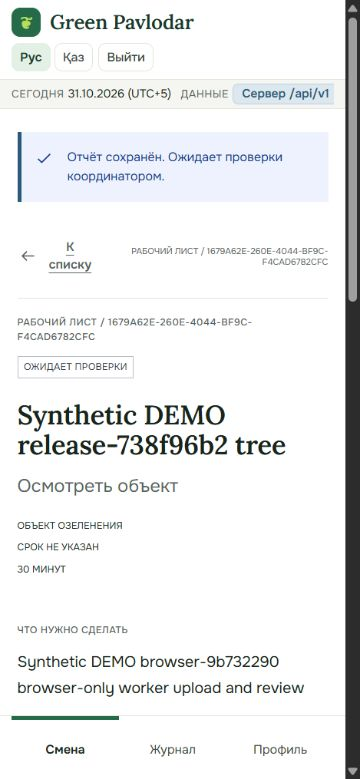
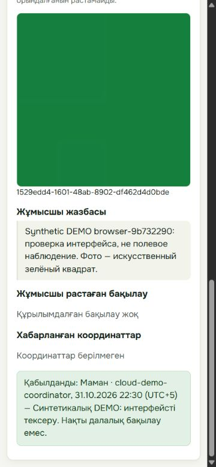
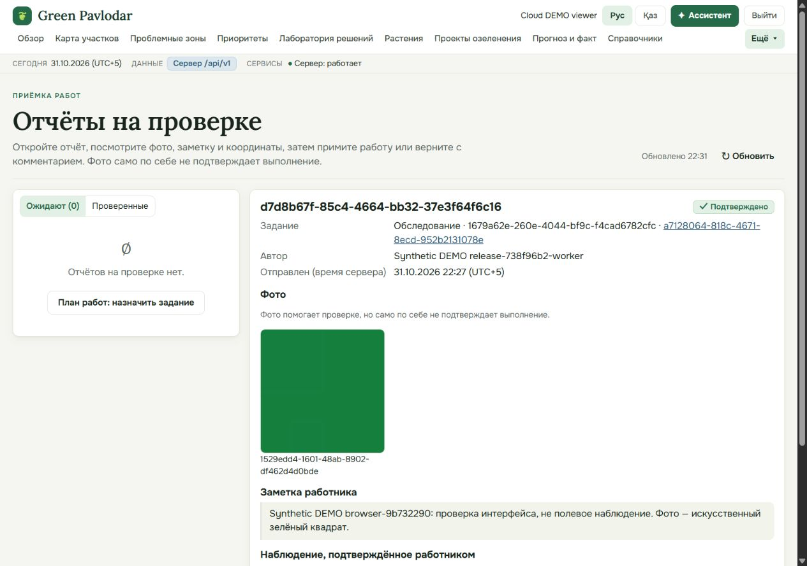
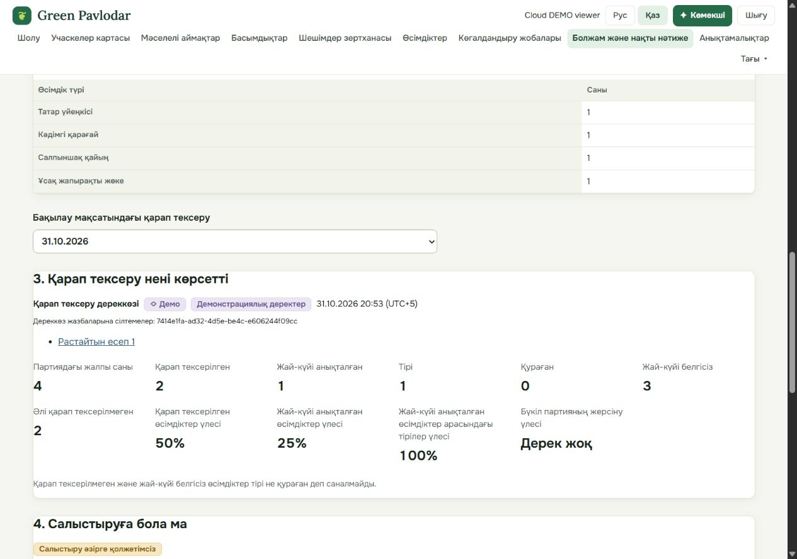
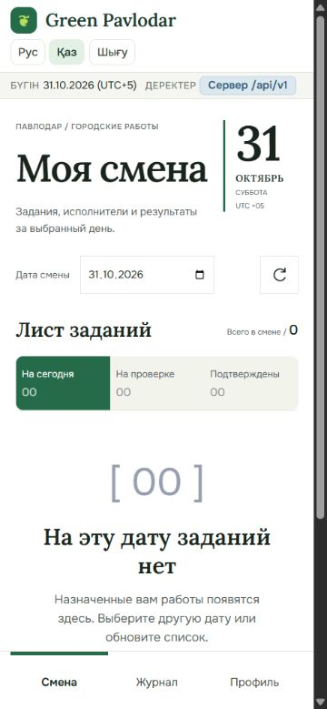

# Реальный браузерный сценарий — 31 октября 2026

Production: https://green-pavlodar-api.pages.dev. Проверка выполнена в доступном браузере,
без mock-ответов, примерно 22:23–22:36 UTC+5. Backend app:
`3b14927def04b35bf97782eae6b550da276c779f`, Render Live `dep-dbj223h42hec73bqnttg`.
Frontend source `aee7242ee899f1f596a704adba6e1279c37af9df` и deployment
`ff01f45d-69ed-45a9-af1c-ad1d26b8983a` — по [записи владельца #35](https://github.com/foxfordkz-cyber/qadamxpavlodar/pull/35#issuecomment-6546546312).
Здесь frontend не пересобирался и не редактировался. HTTP-приёмка отдельно описана
в [release handoff](cloud-final-release.md).

**Один браузерный ролевой цикл PASS. Полная KK-матрица не принята:** обнаружен дефект языка
кабинета работника. Восемь проверок отображения viewer не означают восемь независимых E2E-циклов.

## Что действительно выполнено

Задание и назначение подготовлены через настоящий API на существующей выделенной DEMO-бригаде.
Это подготовка данных, **не создание задания через UI**. Общий участок, его checks/геометрия/версия
и прежняя партия не изменялись. Смена тестового работника — **1 ноября 2026**; в кабинете надо
выбрать эту дату, а не текущий день 31 октября.

| Шаг | Результат |
| --- | --- |
| Worker login → смена 01.11 → открыть назначенное задание → начать | PASS, реальный браузер, RU 1280 |
| Выбрать файл штатным file chooser, добавить заметку | PASS, синтетический PNG 32×32; геолокация не запрашивалась |
| Переключить RU/KK и 1280/375 до отправки | Фото/заметка сохранены, submit активен, горизонтального переполнения нет; язык кабинета KK — FAIL ниже |
| Worker → отправить отчёт | PASS через UI RU 375: сообщение о сохранении, статус ожидает проверки, фото 1 |
| Coordinator login → открыть отчёт/фото/заметку → принять | PASS через UI KK 375, комментарий явно синтетический; статус «Расталды / Қабылданды» |
| Viewer login → тот же принятый отчёт и приватное фото | PASS; actual same-origin WebP decoded 32×32 |
| Viewer → Outcomes прежней партии | PASS: alive 1, unknown 3, процент всей партии «Нет данных / Дерек жоқ» |
| Logout всех использованных браузерных сессий | PASS; поля входа очищены, временный viewport восстановлен |

Синтетический набор `browser-9b732290`, не полевое наблюдение:

- task `1679a62e-260e-4044-bf9c-f4cad6782cfc`;
- report `d7d8b67f-85c4-4664-bb32-37e3f64f6c16`;
- private photo `1529edd4-1601-48ab-8902-df462d4d0bde`, искусственный зелёный квадрат.

[Открыть отчёт после входа](https://green-pavlodar-api.pages.dev/#/reports?report=d7d8b67f-85c4-4664-bb32-37e3f64f6c16).
Автор и координатор на снимках — синтетические DEMO-профили, не персональные данные участников.
Паролей, cookies, CSRF, ключей Supabase и содержимого файлов окружения в доказательствах нет.

## RU/KK и ширины

| Страница viewer | RU 375 | RU 1280 | KK 375 | KK 1280 |
| --- | --- | --- | --- | --- |
| Принятый отчёт: статус, private image, отсутствие горизонтального overflow | PASS | PASS | PASS | PASS |
| Outcomes: alive 1, unknown 3, процент «Нет данных», отсутствие overflow | PASS | PASS | PASS | PASS |

Это проверки DOM/загрузки изображения/отображения значений в реальном браузере, не полный
визуальный аудит всех страниц. При viewport 375/1280 ширина документа 360/1265 из-за полосы
прокрутки; scrollWidth совпадает с clientWidth. Исходные наблюдения, время, размеры и SHA-256
изображений: [browser-results.json](evidence/cloud-pages-20261031/browser-results.json).

## Оставшийся дефект UI-KK-WORKER

1. На production Pages выбрать «Қаз» и войти тестовым работником.
2. Шапка показывает «БҮГІН», «ДЕРЕКТЕР», «Шығу», а кабинет — «Моя смена», «Лист заданий», «Смена».
3. На открытом задании/форме переключение RU → KK также оставляет русские подписи.
4. Повторено на 375 и 1280; полный reload и новый вход с заранее выбранным KK не устраняют проблему.

Ожидание: язык кабинета соответствует выбранному языку оболочки. Работа с сервером, черновик,
фото, отправка и приёмка не заблокированы. Владелец исправления — frontend/кабинет работника;
Тәңірберді координирует подключение, Айдана независимо повторяет. Backend/worker/frontend код
в этом PR не менялся ради исправления UI. [Передача дефекта и результатов #35](https://github.com/foxfordkz-cyber/qadamxpavlodar/pull/35#issuecomment-6546828382).

Read-only диагностика опубликованного source SHA подтверждает причину:
[WorkerCabinet.tsx:14](https://github.com/foxfordkz-cyber/qadamxpavlodar/blob/aee7242ee899f1f596a704adba6e1279c37af9df/apps/web/src/features/worker/WorkerCabinet.tsx#L14)
не передаёт `locale` в `configure`, а
[worker.mjs:25](https://github.com/foxfordkz-cyber/qadamxpavlodar/blob/aee7242ee899f1f596a704adba6e1279c37af9df/apps/web/src/features/worker/worker.mjs#L25)
использует `locale = 'ru'`. Кроме того,
[strings.mjs](https://github.com/foxfordkz-cyber/qadamxpavlodar/blob/aee7242ee899f1f596a704adba6e1279c37af9df/apps/web/src/features/worker/strings.mjs)
выбирает неполный `kkDraft` только для `kk-draft`, остальные строки берёт из RU.
Простого проброса значения `kk` недостаточно: нужен согласованный locale и завершённый словарь.
Владельцу: после исправления отдельно проверить сохранение
черновика, выбранного фото и Idempotency-Key при смене языка; не принимать один перевод шапки
за перевод всего кабинета.

После исправления нужен повтор **на новом фактически опубликованном frontend SHA**. Прежние
снимки не подтверждают исправление. Полная независимая матрица всех ролей/страниц и другого
устройства остаётся NOT RUN здесь. Новый restart/redeploy после этого браузерного отчёта
не выполнялся; сохранность прежних 956 строк проверена при согласованном redeploy отдельно.

## Снимки проверенных состояний

Отправка работником, RU 375:

Приёмка координатором, KK 375:

Viewer: принятый отчёт и приватное фото, RU 1280:

Viewer: Outcomes с неизвестными состояниями, KK 1280:

Воспроизведение UI-KK-WORKER, KK 375:

