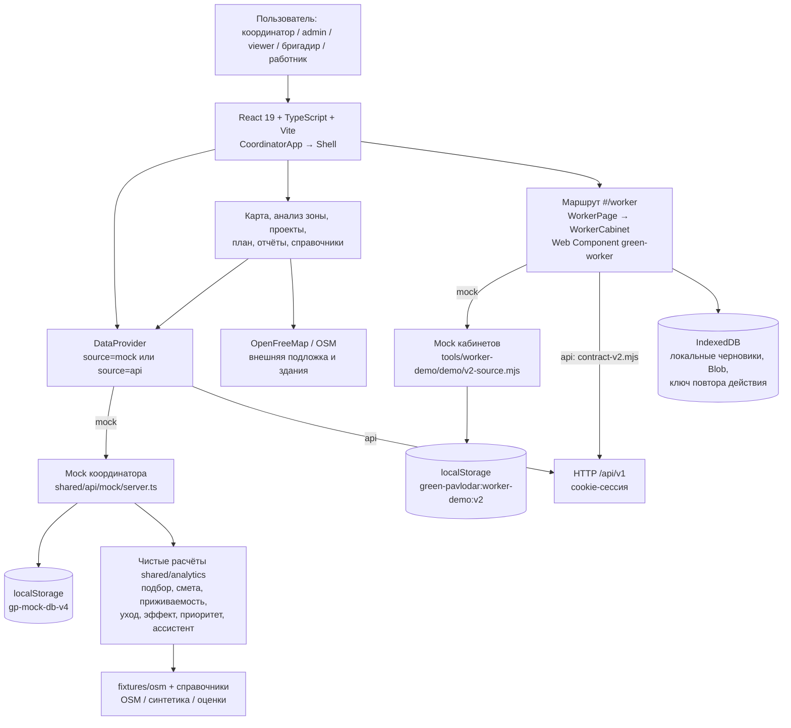
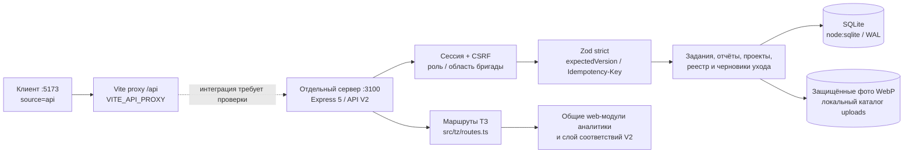

# Архитектура и границы демонстрации

Срез: **29.10.2026**, общая рабочая копия `worker/real-server`, базовый коммит `18c254109478e336beab220f5e492701b29c2897` (`origin/codex/coordinator`). Учитываются уже присутствующие в рабочем дереве интеграционные файлы `WorkerPage.tsx` и `demo-gateway.mjs`. Код параллельно меняется; это схема проверенного состояния файлов, а не подтверждение полной интеграции.

## 1. Фактически имеющийся клиент

**Существенная граница:** mock координатора и mock кабинетов — два отдельных набора данных. У координатора задачи `t-101…`, работники `w-aigerim…`; у кабинетов задачи `GP-104…`, пользователи `demo-worker-1…`. Переход между ролями не доказывает единого потока задания между этими хранилищами. Его следует отдельно проверить после объединения API. Для записи mock допустим показ двух учебных частей с явной подписью, а не заявление о сквозной серверной приёмке.

Локальные черновики хранятся отдельно от серверной истины. IndexedDB не является второй серверной базой. Демонстрационные проверки прав в браузере показывают поведение UI, но не доказывают безопасность сервера.

## 2. Серверная ветка и целевая интеграция

В проверенной основной рабочей копии **нет `apps/server` и `shared/api/v2compat.ts`**. Серверный код прочитан из `origin/server/srv-03-06` на коммите `1fa8e2f61af61a9e53247d2ebf65e9c45e5b8dfe`. По `coordination/qa.md` QA поднял эту ветку в отдельном `work/server-qa`, установил зависимости и выполнил `seed:tz`; это не означает, что сервер объединён с основной веткой.

- Сервер использует Express, Zod, `node:sqlite`, multer и sharp. `Store` включает транзакции, миграции и WAL; факт наличия реализации не подменяет её сквозное тестирование.
- `src/v2/auth.ts` возвращает `user` и `csrfToken`; cookie `gp_v2_session` — HttpOnly, SameSite=Strict в локальном HTTP-режиме. Изменения требуют `X-CSRF-Token`; контроль прав и версий выполняется сервером.
- `src/v2/router.ts` подключает auth, people, domain, reports, intelligence, visualizations и маршруты ТЗ. Swagger: `/api/v1/docs`, контракт: `/api/v1/openapi.json`.
- `src/tz/shared.ts` импортирует **общие исходники web**, включая `analytics/*`, `v2compat.ts`, `tzViews.ts`, `mock/imports.ts` и `mock/drawnZone.ts`. Поэтому сервер нельзя считать автономным пакетом, который достаточно перенести без соответствующей web-ветки.
- В `apps/web/vite.config.ts` значение proxy по умолчанию — `http://localhost:3000`, в текущем QA сервер — `http://127.0.0.1:3100`. Запуск API требует `VITE_API_PROXY=http://127.0.0.1:3100` до старта Vite.
- Исторически QA воспроизвёл `shell.role.undefined` после входа из-за несовпадения формы сессии. **После локального исправления session unwrap этот дефект снят:** coordinator видит роль «Специалист» и навигацию, foreman1 открывает `#/worker`. Эти локальные результаты не означают, что сервер уже включён в основную ветку.
- По финальному `coordination/qa.md` (15:15 UTC+5) сквозной **браузерный** сценарий API всё ещё блокирован: создание обследования координатором отклонено (`requestId e90fdd07-d491-462e-a98c-17dd1130fce0`), экран заданий обращается к отсутствующим маршрутам `/plans` и `/brigades`, проекты — к `/projects` вместо `/designs`; возврат отчёта координатором также отклоняется. При этом foreman1 назначил worker1 и начал подготовленное через API задание, worker1 загрузил синтетическое фото, отправил отчёт и исправил его через UI. Итоговый исправленный отчёт `033e75c5-6f60-4fbe-b0a8-4423e1770c53` принят через API (`requestId b0bde947-8adc-4225-9320-66ed12a23b87`), в браузере показано «Работа подтверждена». Это **HYBRID**: fixture, возврат и приёмка выполнены API, поэтому полный browser E2E не заявляется. Вход/отрисовка всех пяти ролей проверены, выход и session unwrap исправлены. Финальный повтор изменения даты не показывает `null.type`; прежняя ошибка снята после исправления обработчика события.
- **Прямой HTTP-прогон отличается от браузерной интеграции.** В `outputs/qa/api-summary.md` зафиксированы PASS API для обследования с возвратом и исправлением (task `588ae0f2-7d4e-4ed7-8574-8132face3b10`, статус verified) и для посадки (task `c3d14d0b-f751-43a4-9f59-862334841088`, GET подтвердил 2 растения и 2 draft-задания ухода). Повтор с тем же Idempotency-Key вернул прежние IDs; потеря сети не имитировалась. admin и viewer получают ожидаемый 403 при создании задания; чтение всех данных viewer не прошло. Эти результаты не превращают browser E2E в PASS.

## 3. Что действительно означает «без сети»

`source=mock` не требует backend API для тестовых данных и расчётов. Но MapLibre загружает подложку с `tiles.openfreemap.org`, фото видов/города — из внешних источников; в документации модуля прямо сказано, что service worker и полная офлайн-карта отсутствуют. Холодный запуск без интернета не подтверждён. Для резервного показа следует заранее запустить локальную сборку, проверить поведение при отключённой сети и иметь записанный файл с реальным интерфейсом; слайды не являются видео приложения.

Записано **частичное mock-демо** реального приложения: `outputs/defense/mock-demo-partial.webm`, **3:30.96**, 1440×900, 25 fps, VP8, без звука, с поясняющими подписями. Включены основные аналитические экраны, импорт учебного CSV, ассистент, отчёт и отдельный кабинет бригадира. Не записаны полный цикл всех ролей, приёмка посадки и холодный офлайн-запуск приложения. 32 сегмента прошли без ошибок автоматизации и без `pageerror`. Проверены начало/середина/конец; локальный файл целиком воспроизведён в отдельном offline browser context до `ended=true`, `currentTime=210.96`, `error=null`. Это подтверждает автономное воспроизведение видео, а не автономность приложения.

Первую попытку остановило отсутствие Playwright FFmpeg. После отдельного разрешения только FFmpeg и автоматически требуемый Winldd были загружены в частную рабочую папку `qadam-defense/work/playwright-runtime`; общая установка и кэш QA не менялись. Запись сделана установленным Microsoft Edge с отдельным headless-профилем 29.10.2026, 15:22:13–15:25:50 UTC+5. Интерактивный браузер QA не использовался. Подробности и исключения — `video-status.md` в рабочей папке и `mock-demo-notes.md` рядом с видео; полный storyboard остаётся в `scenario.md`.

Текущий `docker-compose.yml` содержит только сервис `web`, сборочный `DATA_SOURCE: mock` и порт `8080:80`. Это не compose web+API+БД. Команда `docker compose up --build` на чистой копии в этой работе не выполнена: Docker Engine отсутствовал по исходному состоянию среды.

## 4. Данные для демонстрационного отчёта

Отчёт пересчитан реальными `analyzeZone`, `priorities`, `roadmap`, `detectProblems` с теми же параметрами, что в `apps/web/scripts/example-report.ts`: `site-osm-1569993037`, вариант `optimal`, уход 3 года, стандартные расценки и веса, бюджет 50 млн ₸. Существующий `docs/example-report.md` не перезаписывался.

**Внешний отчёт и live mock имеют разные входы:** генератор берёт исходный OSM fixture, где доступ к воде неизвестен; `mock/fixtures.ts` задаёт этой зоне учебное `waterAvailability=70` и пройденные проверки. Поэтому live mock при optimal/3 года показывает 10 831 618 ₸, а внешний отчёт — 10 839 718 ₸ (резерв отличается на 8 100 ₸). Сравнение допускается только при совпадающих входах; наличие одинакового ID зоны не делает эти снимки идентичными. Видеозапись сохраняет реальные значения интерфейса, без подмены под цифры отчёта.

| Показатель | Получено из генератора | Класс данных |
|---|---:|---|
| Зон в исходном наборе | 114 | Контуры OSM, не земельный реестр |
| Площадь зоны «Газон у улица Толстого» | 3 782 м² | Открытые данные OSM / производный расчёт |
| Почва | солонцеватая, pH 8,6, сильное засоление | **Синтетика** |
| Смета | 10 839 718 ₸ | **Демо-расценки и оценка** |
| План: деревья / кустарники / цветы | 54 / 270 / 1 021 шт. | **Расчётное предложение** |
| Приживаемость 1 / 2 / 3 года | 83 / 81 / 79% | **Экспертные правила, не калиброваны** |
| CO₂ на 5 / 10 / 20 лет | 0,51234 / 1,02468 / 1,7078 т/год | **Оценочный эффект, не измерение** |
| Дорожная карта на 50 млн ₸ | 29 зон; 49 779 198 ₸ | **Жадная эвристика, не оптимум** |

Нулевое число выявленных деградирующих насаждений не означает отсутствия деградации: нет нужных данных о состоянии. Пыль и зелень на жителя не рассчитаны. OSM не подтверждает юридическую доступность земли; учебные проверки не заменяют обследование и согласования.

В JSON для авторов отчёта сохранены необработанные числовые значения, названия видов, все статьи сметы, уход, эффекты, веса, данные приоритетов и трассировка источников. В PDF и Excel числа должны округляться только при отображении и сопровождаться пометкой «демонстрационные данные / синтетические почвы / оценочные расчёты».

## 5. Источники и проверка

| Источник | Что подтверждает |
|---|---|
| `README.md` | Стек, режимы, модули, допущения и данные OSM |
| `apps/web/src/main.tsx`, `features/coordinator/Shell.tsx` | Общая оболочка и подключение `#/worker` |
| `apps/web/src/shared/api/DataProvider.tsx`, `transport.ts` | Выбор mock/api и HTTP-интерфейс |
| `apps/web/src/shared/api/mock/server.ts`, `fixtures.ts` | Хранилище mock координатора и демо-сущности |
| `apps/web/src/features/worker/WorkerPage.tsx`, `demo-gateway.mjs` | Отдельный источник mock кабинетов и gateway API |
| `tools/worker-demo/demo/v2-source.mjs`, `v2-fixtures.mjs` | Ключ хранилища и синтетические кабинеты |
| `apps/web/src/features/worker/drafts.mjs`, `docs/worker/integration.txt` | IndexedDB, граница доверия, отсутствие полной офлайн-карты |
| `apps/web/src/shared/analytics/{plan,city,zone,rates}.ts` | Выполненные расчёты и происхождение коэффициентов |
| `apps/web/src/shared/api/mock/species.ts`, `fixtures/osm/sites.json` | Каталог, OSM snapshot `2026-10-27T16:03:50Z`, лицензия ODbL 1.0 |
| `origin/server/srv-03-06:apps/server/src/{app,db}.ts`, `v2/{auth,router}.ts`, `tz/shared.ts` | Серверная архитектура и импорт общих web-модулей |
| `apps/web/vite.config.ts`, `docker-compose.yml` | Proxy и фактический состав compose |
| `coordination/qa.md` (внешняя папка координации) | Текущая готовность отдельного сервера и браузерный блокер API |

**Выполнено:** чтение указанных файлов и ветки; проверка отсутствия `apps/server` и `v2compat.ts` в общей копии на момент среза; пересчёт отчёта Node.js 24.19.0 с фактическими исходными модулями. **Не выполнено в рамках этой схемы:** проверка ролей в браузере, чистая Docker-сборка, доказательство сквозного mock/API-процесса, измерение качества агрономических моделей.
